# mi_like_ui

小米风格（HyperOS 设计语言）Flutter UI 组件库：玻璃导航、折叠顶栏、搜索栏、
弹框等成套组件，像素级设计规格、明暗双模式、响应式布局。

组件视觉与动效规格取自设计度量（像素级测量），沉淀为分层清晰、可持续扩充的
组件库；渲染行为由视觉回归测试锁定。

## 特性

- **成套组件**：玻璃悬浮底部 / 侧边导航栏、胶囊标签行、胶囊按钮、搜索栏、
  大标题折叠顶栏、渐进模糊、主题卡片、弹框
- **连续圆角**：全库圆角为 Squircle（G2 连续曲率，HyperOS / iOS 标志性
  角形，边缘高光不打折），半径语义与度量值不变
- **明暗双模式**：全部组件提供深 / 浅两套配方，`MiThemeMode` 统一切换
- **像素级设计规格**：几何、排版、配色、动效曲线均以设计规格数值定义
  （见各组件 `*_metrics.dart`），跨字体排版稳定（基线锚定）
- **透明 / 磨砂体系**：模糊、叠色、玻璃膜参数集中在
  `MiTransparencyTokens` 单一来源，组件只引用不重复定义
- **响应式**：手机 / 平板 / 桌面三档断点，导航形态（底部栏 / 窄侧栏 /
  展开侧栏）、网格列数、等比缩放画布
- **桌面语义**：指针悬停叠色与卡片快捷操作条、键盘焦点环与 ⌘K 快捷键 ——
  触屏素材没有这些样张，按通行桌面惯例**推导**
- **性能预算化**：每帧模糊层数与覆盖面积入回归预算，防止渲染开销回退

## 快速开始

运行演示应用（含全部组件、明暗切换、三档窗口自适应）：

```bash
flutter run
```

在应用中使用：

```dart
import 'package:mi_like_ui/mi_like_ui.dart';

// 底部导航栏（宽屏自动建议换侧栏，见「响应式」）
MiGlassNavBar(
  items: [
    MiGlassNavItem(label: '首页', painter: RollerIconPainter(ink)),
    MiGlassNavItem(label: '分类', painter: GridSparkleIconPainter(ink)),
    MiGlassNavItem(label: '我的', painter: SmileyBeretIconPainter(ink)),
  ],
  selectedIndex: 0,
  onTap: (i) => setState(() => _index = i),
  themeMode: MiThemeMode.dark,
);
```

`lib/mi_like_ui.dart` 是唯一对外 API 入口；`src/` 下未导出的实现属内部，
不承诺 API 稳定。

## 组件总览

| 组件 | 说明 |
|---|---|
| `MiGlassNavBar` | 玻璃悬浮底部导航栏（果冻胶囊选中动效、可挂 FAB） |
| `MiGlassSideNavBar` | 玻璃悬浮侧边导航栏（宽屏 / 桌面形态，与底部栏同语义同配方） |
| `MiPillTabBar` | 胶囊分类标签行（选中胶囊磨砂透镜、出血滚动） |
| `MiButton` | 胶囊按钮（主 / 次级 / 禁用三态） |
| `MiSearchBar` | 搜索栏（静态展示 / 可输入两态，磨砂与导航栏同源） |
| `MiSearchCancelButton` | 搜索取消按钮（搜索态配套） |
| `MiTopBar` | 大标题折叠顶部导航栏（渐进磨砂材质、可内嵌搜索栏 / 标签行、搜索态） |
| `MiGradientBlur` | 内容顶部渐进模糊（可独立使用，不依赖顶栏） |
| `MiThemeCard` | 预览卡片（竖向按度量比例，宽屏可换横版） |
| `MiDialog` | 弹框（遮罩 + 卡片、三档位置、两种形态：横排按钮 / 纵向操作列表、按压动效、高度上限 clamp） |
| `MiPullUpPanel` | 弹出面板（从触发按钮弹起长高、弹簧动效、自定义高度与内容、无压暗） |
| `MiCardPageRoute` | 页面推入转场（右侧滑入 + 前缘圆角、下层页视差与压暗） |
| `MiScaledCanvas` / `MiResponsiveGrid` / `MiViewport` / `MiBreakpoints` | 断点判定、等比缩放画布、响应式网格（列数 / 单元宽上限） |
| `MiContentColumn` / `MiHoverFeedback` | 宽屏内容列限宽、指针悬停反馈（桌面语义） |
| `MiFocusRing` | 键盘焦点环 + Enter / Space 激活（桌面可达性） |

## 组件

### 玻璃悬浮底部导航栏（MiGlassNavBar）

悬浮式玻璃材质底部导航栏，选中态为**高磨砂块**（暗色：白@28% 叠暗化、
不开洞；亮色：暖灰玻璃体 —— 实测参考里选中块几乎不透内容，不是透明
窗口），支持果冻形变的切换动效（按压挤压、拖拽跟随、弹簧沉降），可挂载
浮动圆钮（`MiGlassNavFab`）。

**规格**（详见 `MiGlassNavMetrics`）：栏高 55.4dp、左右边距 25.5dp、
单格宽 82.2dp、胶囊高 49.3dp、图标高 23.2dp、标签 10.5dp Medium；
FAB 直径 55.4dp。玻璃配方（σ = 9.0dp 磨砂、栏体遮罩、选中块、外缘高光）见
`MiGlassPalette` 与 `MiTransparencyTokens`。

导航条目由 `MiGlassNavItem`（标签 + 图标 painter）声明，`selectedIndex` /
`onTap(index)` 受控；`MiGlassNavFab` 可选，与栏体显隐契约、弹出曲线同源。

 

### 玻璃悬浮侧边导航栏（MiGlassSideNavBar）

底部栏的纵向形态，用于宽屏 / 桌面：容器宽 **> 600dp** 时建议改用侧栏
（判定函数 `MiBreakpoints.usesSideNav(width)`），手机竖屏 / 窄窗保留底部栏。
两者共用同一份 `MiGlassNavItem`、`selectedIndex` 与 `onTap`，选中反馈与交互
语义完全一致；玻璃配方、动效曲线复用底部栏 token，仅运动轴换向。

**两种形态**：

| 形态 | 判定 | 栏宽 | 条目排布 |
|------|------|------|----------|
| 窄栏（默认） | 容器宽 > 600 | 95.4dp（度量换算） | 图标在上、小字在下 |
| **展开栏**（`expanded: true`） | 容器宽 ≥ 1024（`usesExpandedRail`） | **176dp**（推导值） | 图标在左、标签在右 |

展开栏是**桌面档的常驻侧栏**，宽度按标签实际字号（`navLabel` 10.5dp）反推：
`2×内缩 18 + 图标 24 + 间距 12 + 标签 + 2×栏内边距 6.6` —— 2 字标签 106、
6 字 148、8 字 169，取 **176** 留一档余量。平板竖屏仍走窄栏 —— 展开栏 +
留白占 768 宽的 26%，不划算。两种形态的纵向节奏（条目高 49.3、间距 8、
栏体圆角与胶囊同心等距 6.6）与飞行动效逐帧同源。

> 首版按 240dp 推导时把标签当成 13.85dp（那是胶囊标签 `pillLabel` 的字号）
> 又翻倍留量 —— 实际展开态用 10.5dp，结果「首页」这类 2 字标签的选中胶囊
> **70% 是空白**。宽度该跟着内容走，不是跟着别人的栏走。

**规格**（详见 `MiGlassSideNavMetrics`）：条目高 49.3dp、条目间距 8dp；
FAB 挂于栏尾下方、栏体不为其让位。侧栏几何为底部栏规格的纵向换算（推导值）。
内容列在侧栏列之外再让出 **24dp 分隔留白**（`contentSeparation`，推导值 ——
栏体是浮在页面底色上的玻璃面板、内容横幅又通栏满铺，相贴时没有呼吸感），
外壳与几何测试同源取 `contentInsetFor(expanded:)`。

> **形态切换建议直接替换子树、不做淡入淡出**：`Opacity` /
> `AnimatedSwitcher` 会对含 `BackdropFilter` 的子树引入 saveLayer，
> 切换期间磨砂会整段消失。

  

### 胶囊分类标签行（MiPillTabBar）

横向分类标签行，选中项为磨砂玻璃胶囊（透镜），支持出血滚动；适合吸顶
分类切换场景（滚动内容可从半透明胶囊后方经过）。

**规格**（详见 `MiPillTabMetrics`）：胶囊 87.6×39.9dp、胶囊间距 /
两端留白 11.9dp、标签 13.85dp Medium；磨砂膜与填充配方见
`MiPillTabPalette` 与 `MiTransparencyTokens`。

**宽度两档**（`itemWidthMode`）：默认 `fixed`（度量定宽，行为逐像素不变）；
`MiPillItemWidth.adaptive` 按标签文字自然宽取
`clamp(文字宽 + 2×16, 87.6, 175.2)`（上限内缩均为**推导值**），超出上限以
省略号截断，填充 / 磨砂裁形 / 内缘亮边三遍对齐同一宽序列。

**压内容膜带**（`overContent: true`）：胶囊行垫一层**行区限定**的玻璃膜带
（**推导值**：羽化高 8dp，与头部磨砂羽化收尾同一语言）——膜只覆盖胶囊行
那一段、上下缘羽化，行外与胶囊间隙不垫；胶囊填充两态同值。

 

### 胶囊按钮（MiButton）

胶囊形按钮，主 / 次级 / 禁用三态；宽度随内容自适应。

**规格**（详见 `MiButtonMetrics`）：高 28.3dp stadium、左右内边距 17dp、
标签 13dp Medium；主按钮填充 `MiColors.accent`（#4980F7，明暗同色）。
`onPressed` 为 `null` 时进入禁用态。

 

### 搜索栏（MiSearchBar / MiSearchCancelButton）

圆角搜索栏，两态：

- **静态展示态**：放大镜 + 占位文字，可点按；
- **输入态**（`editable: true`）：真实 `TextField`，支持 `controller` /
  `focusNode` / `onChanged` / `onSubmitted` 等标准输入参数。

**规格**（详见 `MiSearchBarMetrics` / `MiSearchCancelMetrics`）：栏高 44.1dp、
图标 17.8dp、图标与文字间距 12dp、正文 16.5dp；取消钮直径 44.1dp（等于
栏高）。磨砂与填充同导航栏透明体系。

搜索态配套的布局行为（取消钮淡入、让位、光标闪烁）见「搜索态」一节。

### 大标题折叠顶部导航栏（MiTopBar)

滚动联动的顶栏，两种标题形态与可选头部区：

- **大标题折叠**：大标题随内容滚动上移并沿独立曲线淡出，紧凑标题在
  高度约 20dp 处淡入衔接，两段不重叠；标题基线以 `Baseline` 锚定，
  垂直落点不随字体族漂移；
- **头部区内嵌**（可选）：传 `searchHint` / `tabs` 等数据参数，顶栏内部
  产出 `MiSearchBar` / `MiPillTabBar` 并统一解析明暗配方；需要自定义时
  可用同名插槽 `searchBar` / `tabBar` / `header` 替换（与数据参数互斥，
  构造期校验）；
- **搜索态**（`searchActive` / `onSearchCancel`）：内置搜索栏切换为输入态，
  右侧淡入取消钮、胶囊标签淡出并退出排版；
- **材质开关**：`showBlur`（顶部磨砂）与 `showSurface`（顶部压色）独立控制；
- **命名配方档**：`palette` 可选（null = 按明暗取 `MiTopBarPalette.of`）；
  传 `MiTopBarPalette.transparentFor(mode)` 即**透明顶栏档**（推导）——
  零叠色 + 无实心段，配合 `showBlur: false`（σ=0）与常亮内缘亮边，阅读页
  这类「叠在任意内容上、靠亮边读分隔」的顶栏一行切到该形态；
- **磨砂曲线公开**：`MiTopBar.headerBlurBands(palette, extent: …)` 是「有
  头部区」形态的**权威渐进曲线**（公开 API）—— 宿主自拼浮动头部（如书架
  首页）与顶栏消费同一条曲线，不抄第二份事实源；
- **宽屏收敛**（三个参数，手机档传默认值逐像素不变）：
  - `headerTopInset` —— 头部区顶部让位。桌面传 **24**（`desktopHeaderTopInset`，
    推导值：窗口没有状态栏，留度量 56 会悬出一条空带）；
  - `searchBarMaxWidth` —— 搜索栏限宽。桌面传 **520**（推导值：1120dp 列上一条
    满宽搜索框难用也不像桌面应用，右侧留给动作区）；
  - `actions` —— 搜索栏右侧的动作区（按钮 / 图标一排，右对齐到 `headerInset`）。
    随搜索转场淡出并退出排版（同胶囊行动画契约）；`Opacity` 只包**无磨砂**的
    动作件，磨砂子树进这层会让 backdrop 变空。
- **`sigmaScale`（滚动降 σ）** —— 磨砂 σ 缩放系数，默认 1.0（度量材质）。
  滚动中 backdrop 每帧重算是最贵的一块，宿主可**随速度逐帧**压低（如 0.6…1.0
  连续映射，demo 的 `_ScrollSigma`）：σ 与高斯成本近似线性，运动掩蔽下视觉
  几乎无差，GPU 省近半。**不要用布尔开关硬切**（停顿瞬间「突然变糊」很扎眼，
  实机反馈）；两套磨砂曲线的 σ 各自走 `MiFilterCache` 缓存、跨帧复用。

**规格**（详见 `MiTopBarMetrics`）：紧凑标题 18.0dp Medium（居中）、
大标题 31.83dp Medium；内容首行顶缘分两档 —— 卡片类 `contentTopInset`
183dp、搜索栏类 `searchBarTopInset` 168.5dp；返回圆钮直径 44.1dp
（`showBack: true` 显示，`onBack` 决定可点性）。

**磨砂材质**按是否有头部分两种形态：

- 无头部区（纯标题 / 纯材质）：**渐进磨砂** —— σ 自栏顶 5.37dp 向下衰减，
  在材质盒底归零（曲线标称跨度 119dp，按盒高等比拉伸）；
- 有头部区（搜索栏 + 标签行）：**渐进磨砂（头部区度量）** —— σ 自栏顶
  平台段 8.5dp 向下线性衰减，胶囊行底之后约 6dp 羽化收尾（曲线标称跨度
  158dp，按盒高等比拉伸；1220×2656 明暗双素材实测，见 `MiHeaderBlurProfile`）。

Flutter 无位置相关模糊，渐进曲线以**分段定 σ 阶梯**实现（相邻段 σ 比
≤ 1.5、段高 ≤ 17dp，视觉无台阶）；高度以 `bar.occupiedHeight(context)`
对外声明，供滚动内容让位。

**玻璃零件**（搜索栏 / 未选胶囊）另有自身的透明模糊（σ 9.0dp）与
**内缘亮边**（「边缘逐渐变亮」的受光边）；亮边不是常驻描边 ——
**内容靠近顶栏一定程度才亮**（实测触发距离 ≈20dp），顶栏按滚动位移
下发 `rimProgress`（`MiTopBarMetrics.rimFadeDistance`），静止且内容较远时
亮边 = 0。

下图每格分别为：纯材质形态、顶层页（首行搜索栏）、次级页（返回钮 + 卡片）、
滚动折叠中（紧凑标题浮现）：

 

### 顶部渐进模糊（MiGradientBlur）

「内容顶部被磨开、越往下越清晰」的渐进模糊层，可独立挂载于任意滚动内容，
不依赖顶栏：

```dart
Stack(children: [
  ListView(children: [...]),
  Positioned(
    top: 0, left: 0, right: 0,
    child: MiGradientBlur(height: 120), // 120dp 内由 σ5.37 衰减至 0
  ),
]);
```

曲线形状固定、作用区高度随 `height` 等比伸缩，区底无硬边。上层若有
不透明压色，可传 `opaqueScrimBottom` + `underSurface: true` 跳过被完全
遮住的段落以节省渲染（此配置下压色必须不透明）。`MiTopBar(showBlur: true)`
内部即复用本组件，曲线与几何同源。

**`sigmaScale`（滚动降 σ，推导值）**：σ 缩放系数，默认 1.0 = 度量材质。
传 < 1（如 0.6）可等比压低**运动中**每段的 σ —— 曲线形状（段位 / 段高）
不变、只改强度，σ 与高斯成本近似线性。实现上有两条省帧护栏：σ 缩放
**量化到 0.05 档**（`MiFilterCache` 以 σ 为键，连续值会每帧新建 native
filter）；快速运动（scale ≤ 0.8）时 9 段阶梯**合并成 3 段**（运动掩蔽下
不可辨），停下自动恢复。宿主建议按**滚动速度逐帧映射**（参考 demo 的
`_ScrollSigma`），实时渐变、不在停顿瞬间跳变。

### 主题卡片（MiThemeCard）

竖向预览卡片：上部预览图（定比 259:472、圆角 12.9dp）、下部单行标题
（13.85dp Medium，较图左缘内缩 8.8dp，与区块标题同列起排）。

**悬停快捷操作**（`quickActions`，桌面）：非空时指针悬停会让预览图**底部**
滑出一条操作条（黑 @45% 底，`MiTransparencyTokens.cardQuickActionsScrim`），
移出后滑回。静止态**零像素变化**（结构恒定，黄金图不受影响）；滑入用
`AnimatedSlide`（Transform，**不引 saveLayer**），不用 `Opacity`。操作条按钮
的点按不冒泡到卡片的 `onTap`。手机档不传（触屏无悬停语义）。

 

### 弹框（MiDialog）

遮罩 + 卡片一体的模态弹框，明暗双模式；支持三档位置、两种形态（横排按钮 /
纵向操作列表）、三种按钮形态、按压动效，卡片高度随正文行数自适应并**受屏内
高度上限约束**（超出可用高时 clamp，正文 / 列表区转内部滚动，不再顶出屏幕）。

**规格**（详见 `MiDialogMetrics`）：卡片宽 369.2dp、圆角 49.3dp、底缘距屏
32.9dp；标题 18.0dp、正文 15.9dp（行距 23.2dp、内容内缩 28dp）；按钮高
49.9dp、圆角 15.0dp、行内缩 24.2dp、按钮间距 12.6dp；标题 / 正文 / 按钮
标签的垂直落点以 `Baseline` 锚定，跨字体稳定。

```dart
MiDialog(
  position: MiDialogPosition.bottom,   // top / center / bottom（默认 bottom）
  title: '删除联系人',
  message: '确定从本地和云端同时删除"方太安装师傅"吗？',
  messageAlign: TextAlign.start,       // 默认居中
  actions: [
    MiDialogAction(label: '取消', onPressed: close),
    MiDialogAction(
      label: '删除',
      style: MiDialogActionStyle.destructive,   // neutral / filled / destructive
      onPressed: close,
    ),
  ],
  onScrimTap: close,
);
```

- **位置**（`MiDialogPosition`）：`bottom`（默认）/ `top`（让开安全区）/
  `center`；
- **按钮形态**（`MiDialogActionStyle`）：`neutral`（中性填充）/ `filled`
  （强调填充 + 白字）/ `destructive`（中性填充 + 红字）；
- **遮罩**：亮色黑 @0.20 / 暗色黑 @0.60，点按触发 `onScrimTap`，由宿主
  决定收起；
- **按压动效**：按下时填充叠按压色（亮色压暗 / 暗色提亮，@0.12），标签
  不变、不缩放，150ms `easeOutQuad` 过渡，松开回弹。

**宽屏档**（容器宽 ≥ 1024，`MiDialogMetrics.isWide`）：卡片改为**居中窄卡** ——
限宽 **440dp**、圆角 **16**、`position` 只在手机档生效。两者都是**推导值**
（正文行长 ~40 字的可读上限；居中卡通行圆角 —— 手机的 49.3 圆角是「贴底
圆角卡」的度量，居中形态没有这条语义）。正文行数按**实际卡宽**排版，窄容器
里卡片收到可用宽内、不溢出。

静止态（左「删除联系人」/ 右「删除1项资源」两种内容形态）与按压态（右列）：

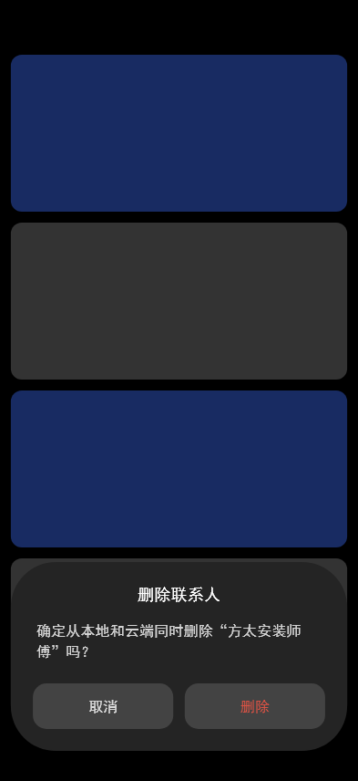 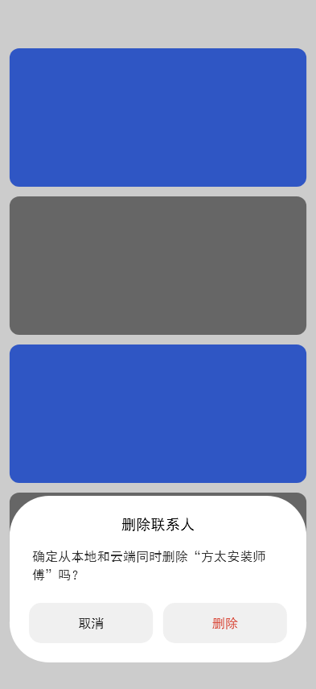 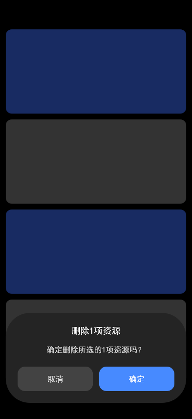 

三档位置：

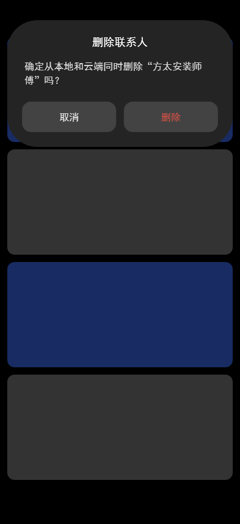 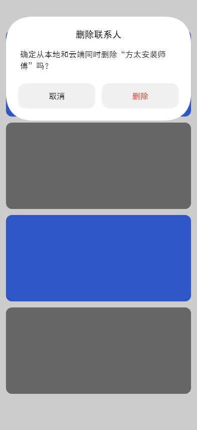 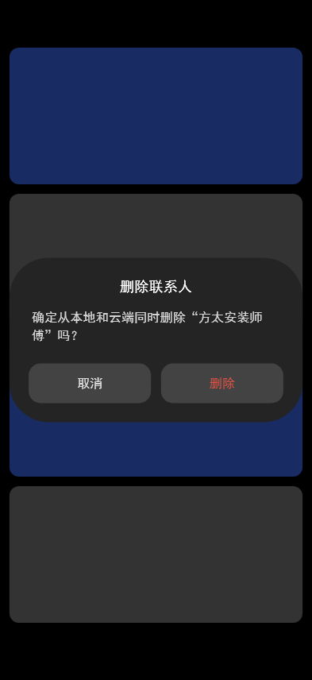 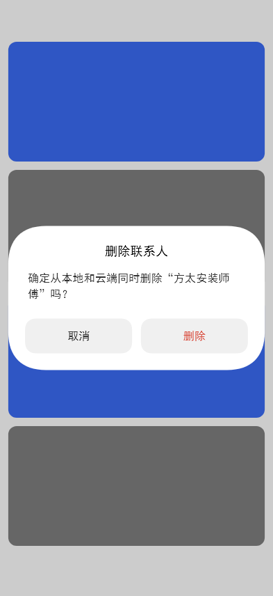

**纵向操作列表形态**（`MiDialogLayout.list`，下游「长按图书 → 操作面板」
场景）：每项 = 可选前导图标（22dp）+ 主文案 + 可选副标题，项间 1dp 分隔线、
危险项整行红字；标题左对齐最多两行；可与 `actions`（如「取消」）同用，按钮行
恒钉卡底。列表几何**无参考素材、全部为推导值**（取值口径见 `MiDialogListMetrics`
类注释），配色沿用 `MiDialogPalette`（分隔线为 onSurface @0.08 推导值）。

```dart
MiDialog(
  layout: MiDialogLayout.list,
  title: '图书操作：《置身事内：中国政府与经济发展》',  // 左对齐，最多两行
  items: [
    MiDialogItem(
      label: '收藏到书架',
      icon: Icon(Icons.star_outline, size: 22),          // 可选；随行墨色 / 危险色
      onPressed: close,
    ),
    MiDialogItem(
      label: '下载到本地',
      subtitle: '离线阅读，Wi-Fi 下自动更新',            // 可选
      icon: Icon(Icons.download_outlined, size: 22),
      onPressed: close,
    ),
    MiDialogItem(
      label: '删除',
      subtitle: '从书架移除并删除本地文件',
      destructive: true,                                // 整行（含图标）红字
      icon: Icon(Icons.delete_outline, size: 22),
      onPressed: close,
    ),
  ],
  actions: [MiDialogAction(label: '取消', onPressed: close)],
  onScrimTap: close,
);
```

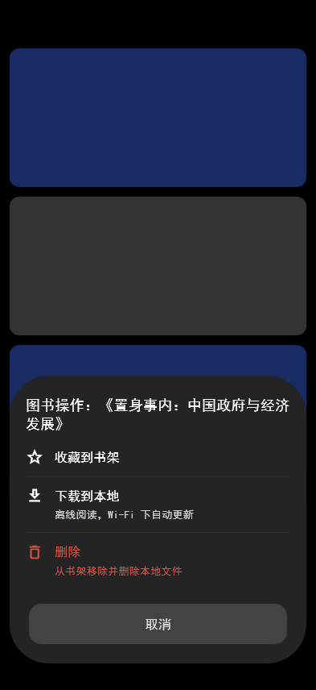 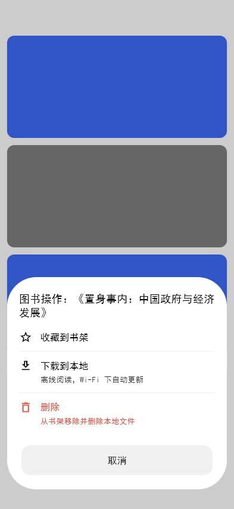

### 弹出面板（MiPullUpPanel）

从触发按钮**弹起并长高**的模态面板（参考 HyperOS 拨号键盘唤起录屏，含
0.25× 慢速浅色段逐帧复核）：点按右下圆钮后，面板从按钮**等比放大**到
终态（弹簧 ~0.53s、~1.3% 过冲，拟合 stiffness 260 / damping 26，**全程
不淡入** —— 逐点透明度反解 q≡1），贴在底部导航栏之上；收起时沿同一路径
**反向缩回按钮**（临界阻尼弹簧 ~0.19s，拟合 530/46）+ **淡出 = 回收进度**
（慢速素材 42ms 处几何 0.82 / 透明 0.84），收口后回调 `onDismissed` 由宿主
移除。缩放原点逐帧拟合素材（横向恒定于终态右缘 −20.9dp、纵向从按钮圆心
扫到屏底 −2×90dp —— 后者正是面板「向上长」的观感来源，残差 ≤11dp）。
面板外**不压暗**（度量：面板外页底像素不变），面板外点按触发收回。**高度
与内容完全自定义**：内容在终态尺寸下排版、随面板一起缩放（过程中不重排版）。
触发按钮的**震动反馈**属按钮自身（demo 圆钮已接 `HapticFeedback.lightImpact()`），
面板不代发；demo 圆钮展开时同步**交叉淡变**（绿⇄暗 #131313 / 白 #FBFBFB，
点阵白⇄黑，均为度量）。

**规格**（详见 `MiPullUpPanelMetrics`）：宽 = 屏宽 − 2×24dp、圆角 33dp、
底距屏底 90dp、轻投影（浅色度量拟合：黑 @0.12 / blur 14 / 下偏 4；暗色黑底
不可分辨）（几何均为度量）；表面暗 #2C2C2C / 亮 #FFFFFF（两段素材分别实测）；
起点尺寸 = 触发按钮直径（默认 54.1dp 度量）、锚点默认取素材按钮位（推导，
调用方应传真实按钮圆心的全局坐标）；宽屏档（≥1024）限宽 440（推导，沿用
弹框宽屏口径）。

```dart
final panelController = MiPullUpPanelController();

MiPullUpPanel(
  height: 240,                       // 自定义长高（null = 内容自适应）
  anchorPoint: fabCenter,            // 触发按钮圆心（全局坐标）
  themeMode: mode,
  controller: panelController,       // 可编程收起（可选）
  onDismissed: close,                // 收回动画收口后移除
  child: MyPanelContent(),           // 任意内容（终态尺寸下排版）
);
// 面板外点按 / panelController.dismiss() 都会播收回动画后回调 onDismissed
```

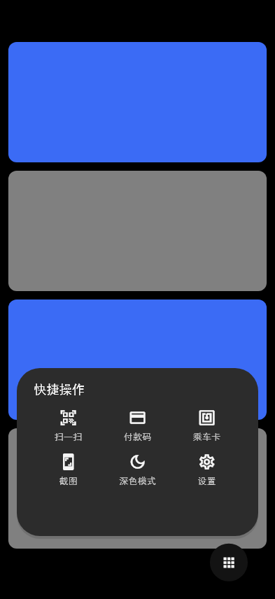 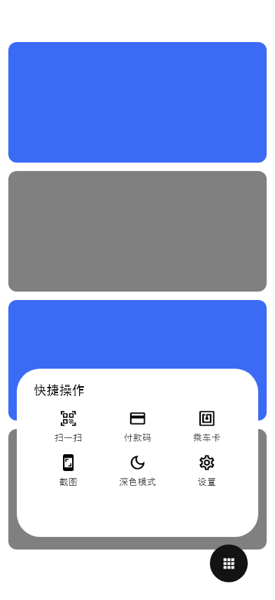

### 页面推入转场（MiCardPageRoute）

自右缘推入新页、前缘带大圆角，下层页同时左移视差并压暗 —— 用于「搜索页 /
详情页」这类推进一级的场景。用法与 `MaterialPageRoute` 一致：

```dart
Navigator.of(context).push(MiCardPageRoute<void>(
  builder: (_) => const SearchPage(),
));
```

**规格**（详见 `MiCardPageRouteMetrics`）：时长 300ms、位置曲线 `easeOutCubic`；
新页前缘圆角 61.2dp；下层页左移 `0.25 × 页宽`（只平移、不缩放）；下层页压暗
由 0 线性升至黑 @0.55。新页归位后不保留任何变换层与遮罩（静止页零额外绘制）。

- **两种角色**：`buildTransitions` 同时处理「本页正在进入」与「本页被上层压住」。
  下层页的视差依赖下层路由同样为本类（`secondaryAnimation` 钩子）；下层是平台
  自带路由时仍有压暗，只是没有视差。
- **压暗以纯色填充实现**，不用 `Opacity` / `FadeTransition` —— 后者会给整页引入
  saveLayer，使下层 `BackdropFilter` 的 backdrop 变空、磨砂整段消失。

**宽屏档**（窗口 ≥ 1024，`MiCardPageRouteMetrics.isWide`）：换桌面通行的
「**4dp 抬起 + 同色幕布淡入**」，视觉时长 **220ms**、前缘圆角 ≤ 16 ——
手机档的「大圆角滑入 + 视差」在桌面读作「两个窗口叠在一起」。淡入同样
**不用 `Opacity`**：新页含磨砂顶栏，套 saveLayer 会让它自己的 backdrop 变空；
改在新页之上盖一层**页底色实色**（`ColoredBox`，普通绘制）做 alpha 1→0，
观感即「从页面底色里浮出来」。下层页不做视差、不压暗。220ms 通过
`Interval(0, 0.73)` 落在 300ms 路由时长的前 73% 段（`transitionDuration`
在构造时定死、拿不到上下文里的窗口宽）。

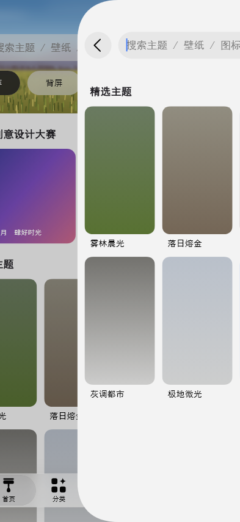 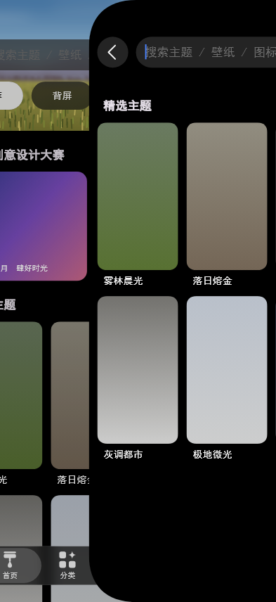 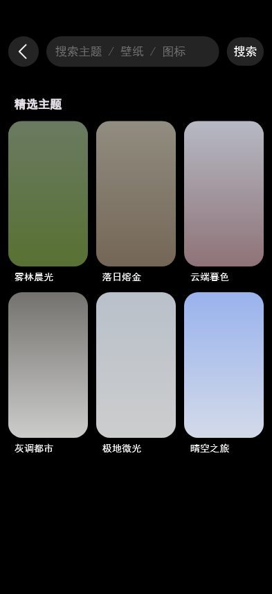

## 材质与透明体系

透明相关参数（模糊 σ、各级填充 / 叠色 alpha、玻璃膜、按压叠色）**只定义于**
`MiTransparencyTokens`，各组件 token 仅引用常量与自身几何；`withOpacity` /
`fromRGBO` / 带 alpha 的色值不允许出现在组件层，由
`test/transparency_config_test.dart` 扫描源码约束。

其中「玻璃膜」用于压在滚动内容上的零件（`overContent: true`）：垫在低调
填充之下，使零件在平坦页面上与普通填充无异、内容滚到其后方时才显出
磨砂玻璃质感，无需随滚动状态切换配方。**胶囊行为行区限定的渐变膜带**
（只覆胶囊行那一段、上下缘羽化，行外与间隙不垫；不再逐胶囊预合成）；
搜索栏等单个控件仍用 `veiledFill` 预合成（控件形状即栏体）。

### 连续圆角（Squircle）

全库圆角容器（卡片 / 胶囊 / 面板 / 转场前缘）均为 **Squircle 连续圆角**：
曲率自直线平滑过渡（G2 连续），边缘高光不打折 —— 普通 RRect 的曲率在
接点从 0 跳到 1/r，高光会打出一个「折」。实现为每角一段三次贝塞尔
（瓦片 = 半径 × 1.1、控制点比例 0.643；思路参考 flutter_miuix
`foundation/miuix_squircle.dart`，Apache-2.0，按本库度量驱动风格重写）。

- **半径语义不变**：各 metrics 里的圆角值仍是名义半径，只换「怎么画」，
  外接几何逐像素不变；胶囊（半径吃满短边）端头为**真半圆** —— squircle
  只修饰有过渡段的部分圆角，不修饰完整端头（45° 径向鼓 4.8% 会失真）；
- **API 面**：`MiSquircleBorder`（ShapeDecoration 用）、`MiSquircleClipper`
  （ClipPath 用）、`MiSquircleShadowPainter`（BoxShadow 的 squircle 版 ——
  ShapeDecoration 不带 boxShadow，带投影的表面用它垫底）；
- **不适用处**：真圆（取消钮 / 返回钮 / FAB）、悬停 / 焦点包装层的
  `borderRadius` 参数（5.6% 叠色下角差不可辨，保留参数避免 API 破坏）。

## 动效体系

动效规格（弹簧 / 时长 / 曲线）与透明参数同构：跨组件复用的动效只定义于
`MiMotionTokens`（`theme/motion_tokens.dart`），组件私有动效留在各
`*_metrics.dart`，实现层不许裸写数值字面量 —— 由
`test/motion_config_test.dart` 源码扫描约束。

- **语义命名**：名字说的是「什么时候用」，不是「数值是多少」。已收录：
  按压叠色 150ms `easeOutQuad`（弹框按压度量）、按压反馈 420/300ms
  `easeOut`（顶栏返回钮度量，搜索取消钮推导沿用 —— 同一套按压语言，
  三方同值由测试钉住）、弹出面板展开 / 收回弹簧（拨号键盘录屏拟合：
  ζ≈0.807 过冲 ~1.4% / 临界阻尼无过冲）；
- **换算工具** `miSpring(damping, response)`：按 Folme 口径
  `stiffness = (2π/response)²` 把设计侧的「阻尼比 + 响应时间」换算为
  Flutter 弹簧（思路参考 flutter_miuix，Apache-2.0，按本库风格重写）；
  已有度量值不强迁 —— 它们是素材拟合的真源，两边注释互写换算关系；
- **三层归属**：跨组件 → tokens（真身）；组件私有 → metrics（玻璃栏
  飞行 / 果冻形变、顶栏搜索转场等）；已迁走的旧常量（如
  `MiTopBarMetrics.pressFadeInMs`）以**同源转发**保留，调用点零改动，
  新代码直接取 token。

## 搜索态

搜索两条路径都支持，按页面结构选用：

**① 原地搜索态**（`MiTopBar.searchActive`）—— 搜索栏就地变输入框，右侧淡入
取消钮（`MiSearchCancelButton`），胶囊标签行淡出并退出排版（`occupiedHeight`
由 156dp 收至 100.1dp）；转场 220ms（起手静止 22ms + 位移 `easeOutQuint`），
取消钮淡入与位移不同步、落在转场中段。示例在「分类」页。

> **转场期的两条绘制约束**：① 胶囊行与取消钮的淡出**乘 alpha**（组件自带的
> `fade` 参数），不套 `Opacity` —— saveLayer 会让子树里 backdrop 变空（磨砂
> 整段消失）、并每帧多一次离屏合成；② 材质盒高在转场中**钉住不插值**，否则
> 磨砂段的 `ClipRect` 每帧重定位、整条头部区的全宽高斯每帧重跑。

**② 推入搜索页**（`MiCardPageRoute`）—— 整页自右缘滑入（见上一节），落定后
头部为「返回圆钮 + 输入框 + 搜索钮」三段：头部行顶缘 52.2dp、圆钮 ⌀44.1dp、
圆钮与输入框 / 输入框与搜索钮各间距 11dp、搜索钮 53.5×40.9dp。示例在首页。

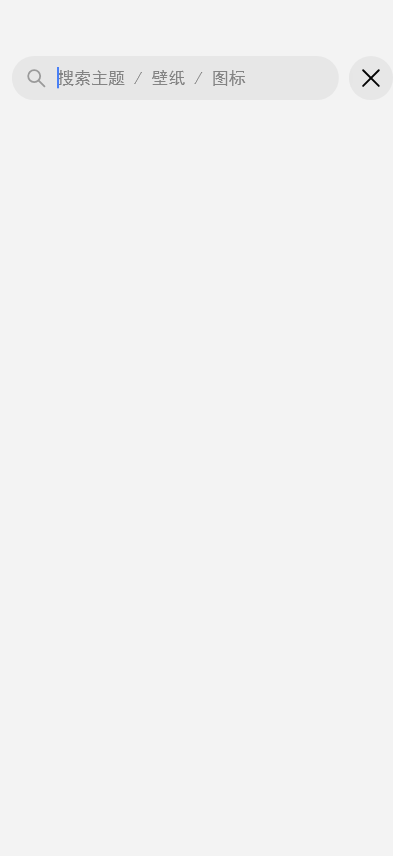  

> 宿主建议：搜索态下收起 App 级导航（专注输入），且键盘弹出时保持画面尺寸
> （`Scaffold(resizeToAvoidBottomInset: false)`），由键盘覆盖而非压缩布局。

> 切换底栏显隐请用换结构（`Visibility` / 条件子树）而非 `Opacity` 淡出，
> 理由同上文「形态切换」。

## 响应式

框架层 `src/utils/responsive.dart` 提供断点判定与等比缩放画布，
示例层 `DemoStage` 据此把内容摆进任意窗口。三类断点各司其职：

| 档位 | 窗口逻辑宽 | 内容列宽 | 网格列数（主题卡 / 展示位） | 导航形态 |
|---|---|---|---|---|
| compact | < 600dp | ≤ 画布宽（393 设计宽） | 3 竖版 / 4 | 底部栏 |
| medium | 600…1023dp | 铺满（页边距 32） | 3 竖版 / 6 | 侧栏（窄栏 95.4） |
| expanded | ≥ 1024dp | **≤ 1120 居中** | 6 横版 / 8 | 侧栏（**展开栏 176**） |

- **窗口断点**（`MiViewport` / `MiBreakpoints.ofWidth`）：决定外壳是否加宽内容；
- **容器断点**（`MiBreakpoints.usesSideNav`，严格 > 600）：决定导航形态；
  判据跟随容器宽度而非窗口宽度，手机画布嵌入宽窗口也不会切换形态；
  同一断点链上再分一层：容器宽 ≥ 1024 换**展开侧栏**（`usesExpandedRail`），
  平板竖屏仍走窄栏 —— 展开栏 + 留白会吃掉 768 宽的 26%；
- **内容断点**（`MiResponsiveGrid`，按容器宽切列）：决定网格列数；
  给了 `maxCellWidth` 时列数还会随宽度**连续增长**，只加列、不把卡片拉宽。

三者判据不同源，请按上表分别取用。等比缩放画布 `MiScaledCanvas` 只缩不放
（`scale = min(1, 可用宽/设计宽, 可用高/设计高)`）：不溢出、不变形，1:1 时
不引入任何变换层。

### 宽屏配方（`MiContentColumn`）

所有度量都在 393dp 手机宽上取得，宽屏若直接沿用，卡片与列表行会被等比拉伸
（1366dp 时单张卡 500dp 宽、设置行 1200dp 长，开关孤零零贴在屏边）。宽屏
需要的是**几条形态规则**，而不是更大的像素：

| 规则 | 取值 | 依据 |
|---|---|---|
| 内容列上限 | 1120dp（`MiBreakpoints.contentMaxWidth`） | 推导：桌面阅读列常见 1000…1200；1120 放得下 5 张 200dp 卡，与手机 3 列同密度 |
| 宽屏页边距 | 32dp（`MiDimens.spaceXxxl`） | 推导：24 在 1000dp 以上偏窄、40 吃掉列宽 |
| 卡片比例 | 手机竖版 259:472（度量）→ 桌面 16:10 横版 | 推导：1366×768 竖版卡一屏只 1.4 行，横版 2 行以上 |
| 单元宽上限 | 主题卡 240dp（`MiResponsiveGrid.maxCellWidth`） | 推导：平板竖屏 736 宽 → 3 列，桌面 → 6 列 |
| 表单内容列 | 720dp（示例「我的」页） | 推导：再宽「标签在左、开关在右」要来回扫视 |
| 展开侧栏 | 176dp（`MiGlassSideNavMetrics.expandedRailWidth`） | 推导：按标签实际字号 10.5dp 反推（8 字 169 + 余量）；宽度跟着内容走 |
| 顶栏顶部让位 | 24dp（`MiTopBarMetrics.desktopHeaderTopInset`） | 推导：窗口没有状态栏，留度量 56 会悬出空带 |
| 搜索栏限宽 | 520dp（`MiTopBar.searchBarMaxWidth`） | 推导：1120 列上满宽搜索框难用且不像桌面应用，右侧留给动作区 |
| 桌面弹窗 | 限宽 440dp / 圆角 16（`MiDialogMetrics` 宽屏档） | 推导：正文行长 ~40 字可读上限；居中卡通行圆角（手机 49.3 是贴底卡度量） |
| 桌面推入转场 | 4dp 抬起 + 同色幕布淡入 220ms（`MiCardPageRouteMetrics` 宽屏档） | 推导：大圆角滑入 + 视差在桌面读作「两个窗口叠在一起」 |

`MiContentColumn` 只限制**内容**：页面底色仍铺满窗口，纵向撑满，不加任何
视觉包装（不做圆角卡片、不加投影）。手机 / 平板画面本来 ≤ 1120dp，套上
也等于未启用，所以这一层可以恒定保留、不按断点增删（增删会重建页面、
跨断点时滚动位置归零）。

### 指针悬停（`MiHoverFeedback`）

参考素材来自触屏手机，悬停语义是**推导**的：叠色 = 按压高光的 60%
（白/黑 @5.6%，`MiTransparencyTokens.hoverOverlayFor`）+ 手型光标，150ms
淡入淡出。已覆盖主题卡、胶囊标签、按钮、搜索栏（可点形态）、底部 / 侧边
导航条目；禁用态不给悬停暗示。

实现上刻意用**实色 `AnimatedContainer`**：`Opacity` / `FadeTransition` 会
引入 `saveLayer`，本库磨砂子树里一旦出现 saveLayer，下层 `BackdropFilter`
的 backdrop 变空（磨砂消失）。未悬停时叠色全透明、结构恒定 → 黄金图与
触屏行为零差异。宽屏另有可见滚动条（`Scrollbar(thumbVisibility: true)`，
手机档不显示）。

   

桌面浅色（侧栏玻璃体与投影落在浅底上，无拼接缝）：


### 键盘可达性

参考素材来自触屏手机，键盘语义是**推导**的（与悬停同一前提）：

- **`MiFocusRing`** —— Tab 聚焦可点元素时，在其**边界外侧**画 2dp 强调描边
  （亮 = 强调蓝 / 暗 = 白，推导值），Enter / Space 触发 `onActivate`。
  描边是**实色 `AnimatedContainer`**：未聚焦时全透明、结构恒定 → 黄金图零变化；
  `enabled: false` 时连 `Focus` 都不挂（不参与 Tab 遍历）。已接入 `MiButton`。
- **`MiSearchShortcuts`**（示例层）—— ⌘ / Ctrl + K 聚焦搜索、Esc 退出当前
  浮层 / 搜索态（`onEscape: null` 时不注册 Esc、继续冒泡给系统）。
  快捷键沿焦点链冒泡，所以搜索框获得焦点后 ⌘K 仍被这一层接住。

> **包装层必须结构恒定**：`_keyboardScope` 三档都挂 `MiSearchShortcuts`，
> 只切其 `autofocus`（手机档不抢焦点 —— 触屏没有物理键盘，抢一次焦点还会把
> 搜索光标的闪烁相位推偏）。跨断点**增删**这层会让页面 Element 重建、滚动
> 位置归零，与「内容列不能按断点增删」是同一条坑。

## 性能

磨砂（`BackdropFilter`）是本库最主要的绘制开销：每帧对 backdrop 重算全
QUAD 高斯，滚动时随 backdrop 变化。为此将「单次构建的模糊层数 + 覆盖面积
（dp²）」固化为性能预算（`test/perf_budget_test.dart`），防止渲染开销回退：

| 形态（深色） | 层数 / 覆盖面积 |
|---|---|
| 手机 393×856 | 首页 / 分类 2 层 / 75,701 dp² · 我的 6 层 / 35,799 dp² |
| 平板 768×1280 | 首页 / 分类 2 层 / 117,843 dp² · 我的 6 层 / 52,142 dp² |
| 桌面 1366×768 | 首页 / 分类 2 层 / **170,050** dp² · 我的 6 层 / **92,174** dp² |

> 桌面档分层（实测）：顶栏磨砂 1120 × **124** = 138,880（列宽触 1120 上限；
> 高 124 = 桌面 `headerTopInset` 24 + 搜索栏 44.1 + 间隙 16 + 胶囊行 39.9，
> 不是手机的 156）+ 展开侧栏 176 × 177.1 = 31,170。比窄栏时代（191,615）
> **降 ~21k** —— 收窄栏宽与桌面顶栏让位 24 两处一起省的；**层数没变**（一次
> 大 filter 比多次小 filter 便宜），阈值按实测 +3% 重标为 175,000。

**滚动降 σ**：磨砂 σ 缩放随滚动**速度**逐帧连续映射（demo `_ScrollSigma`：
0.6…1.0，含惯性收尾的平滑回升）—— 实时渐变，不在停顿瞬间跳变；σ 与高斯
成本近似线性，运动掩蔽下视觉几乎无差，GPU 省近半。入口是
`MiGradientBlur.sigmaScale` / `MiTopBar.sigmaScale`（默认 1.0）。

桌面那一档被**内容列 1120dp 上限**封顶：栏宽收到 176 后可用宽是
1366 − 201.5 = 1164.5，已超过 1120 → 顶栏磨砂宽度钉在 1120，更宽的窗口也
不再涨（首页 / 分类是「头部区渐进曲线铺满一条栏」，我的页是大标题形态的
5 段渐进曲线 + 展开栏）。

已内置的等效优化（视觉零差异）：

1. **跳过被完全遮挡的模糊段**：深色顶栏不透明压色覆盖的区段不参与模糊
   （`MiTopBar.visibleBlurBands`）；
2. **胶囊行模糊合并**：全部胶囊形状一次 `ClipPath` 裁切 + 单次 backdrop
   模糊，相邻胶囊不串色；
3. **`ImageFilter` 按 σ 缓存复用**（`src/utils/filter_cache.dart`），
   σ < 0.5dp 的段（亚像素高斯）不绘制。

性能验证请在 profile 模式下进行（debug 渲染开销数倍于 profile）：

```bash
flutter run --profile                       # 运行后按 P 打开性能 overlay
adb shell dumpsys gfxinfo com.example.bottom_nav_demo reset
# … 在应用里连续滚动 / 切换约 20 秒 …
adb shell dumpsys gfxinfo com.example.bottom_nav_demo | Select-String "Janky frames"
```

## 架构

```
lib/
├── mi_like_ui.dart          # 唯一对外 API（barrel 导出层）
├── main.dart                # 演示应用入口
├── demo/                    # 示例层（演示 app）
└── src/
    ├── theme/               # 样式令牌层（颜色 / 文字 / 间距 / 透明与磨砂，明暗双配方）
    ├── components/          # 组件层（类别 / 组件名 / 两级目录）
    │   ├── navigation/      #   glass_nav_bar · glass_side_nav_bar · pill_tab_bar · top_bar · card_page_route
    │   ├── buttons/         #   button
    │   ├── inputs/          #   search_bar（含取消钮）
    │   ├── cards/           #   theme_card
    │   ├── feedback/        #   dialog
    │   └── effects/         #   gradient_blur
    ├── icons/               # 图标 painter 合集
    └── utils/               # 工具层（断点 / 缩放 / 响应式网格 / 悬停 / 滤镜缓存）

test/                        # 单元 / 交互 / 视觉回归测试
```

| 层 | 职责 |
|---|---|
| 导出层 `lib/mi_like_ui.dart` | 唯一对外 API 面 |
| 组件层 `src/components/` | 可复用组件：widget + metrics + painter |
| 主题层 `src/theme/` | 跨组件样式令牌；透明 / 磨砂参数统一在 `transparency_tokens.dart`，动效规格统一在 `motion_tokens.dart` |
| 图标 `src/icons/` | 导航图标 painter 合集（`*IconPainter`） |
| 工具层 `src/utils/` | 无状态纯函数 |
| 示例层 `lib/demo/` | 演示应用，模拟真实使用方 |

## 开发与贡献

```bash
flutter run      # 运行演示应用
flutter test     # 全量测试（含视觉回归）
```

**命名与组织约定**

- 公共类型 `Mi` 前缀（`MiGlassNavBar`、`MiColors`）；图标 painter 用
  `*IconPainter`
- 文件名 snake_case；组件常量进 `<组件名>_metrics.dart`，配色进
  `theme/` 对应 `*_tokens.dart`
- 使用方与测试只 import barrel；未导出的 `src/` 实现不承诺 API 稳定
- 透明参数只有一个来源（`transparency_tokens.dart`），其余令牌与组件只引用

**新增组件流程**

1. `src/components/<类别>/<组件名>/` 建目录（widget / metrics / painter）
2. 样式取主题层令牌，缺失则先补令牌
3. barrel 补一行 `export`
4. 测试与演示应用各补一例
5. `flutter analyze` + `flutter test` 全绿后提交

**测试**

- 单元 / 交互测试：`test/*_test.dart`
- 视觉回归：`test/*_golden_test.dart`、`test/preview_capture_test.dart`
  （文档配图亦由此生成，样式变更后以
  `flutter test --update-goldens test/preview_capture_test.dart` 刷新）
- 性能预算：`test/perf_budget_test.dart`
- 令牌约束：`test/transparency_config_test.dart`

## 设计规格与度量

本库的视觉 / 动效参数以**设计度量**为准：从设计参考素材按像素测量、换算为
统一设计宽度（393dp）下的规格值；无直接参考的派生值标注**推导**并在源码注释
中写明换算来源。度量数据与推导过程记录于各组件 `*_metrics.dart` 与
`theme/*_tokens.dart` 的文档注释，排版落点采用基线锚定保证跨字体稳定，
渲染行为由视觉回归测试锁定。

## 路线图

- [x] `MiGlassNavBar` — 玻璃悬浮底部导航栏
- [x] `MiGlassSideNavBar` — 玻璃悬浮侧边导航栏
- [x] `MiPillTabBar` — 胶囊分类标签行
- [x] `MiButton` — 胶囊按钮
- [x] `MiSearchBar` / `MiSearchCancelButton` — 搜索栏与取消钮
- [x] `MiTopBar` — 大标题折叠顶部导航栏（材质 / 头部区 / 搜索态）
- [x] `MiGradientBlur` — 顶部渐进模糊
- [x] `MiThemeCard` — 主题卡片
- [x] `MiDialog` — 弹框（含纵向操作列表形态）
- [x] `MiPullUpPanel` — 弹出面板（按钮弹起 / 弹簧动效）
- [x] `MiCardPageRoute` — 页面推入转场
- [x] 响应式工具 — `MiScaledCanvas` / `MiResponsiveGrid` / `MiViewport` / `MiBreakpoints`
- [ ] `MiForm` — 表单
- [ ] `MiTheme` — 主题聚合

## 版本记录

见 [CHANGELOG.md](CHANGELOG.md)，版本号遵循 [Semantic Versioning](https://semver.org/)。
