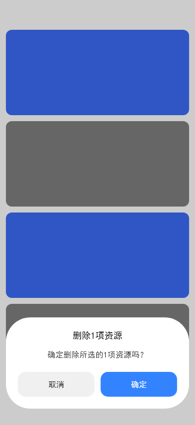
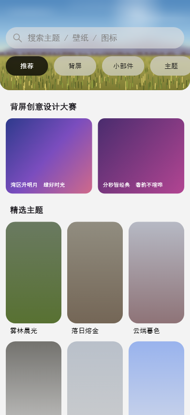
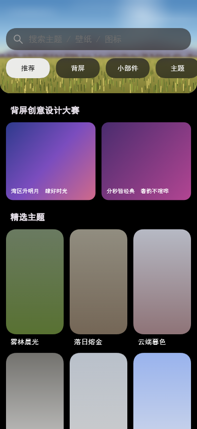
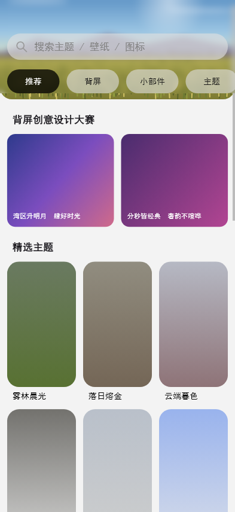
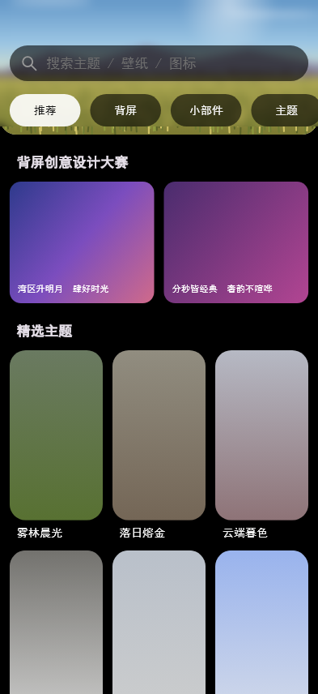
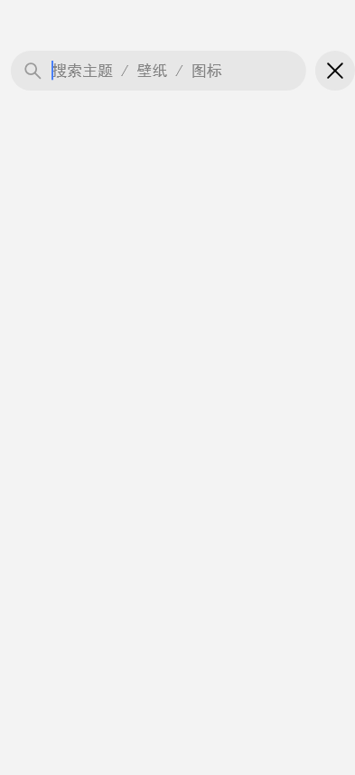
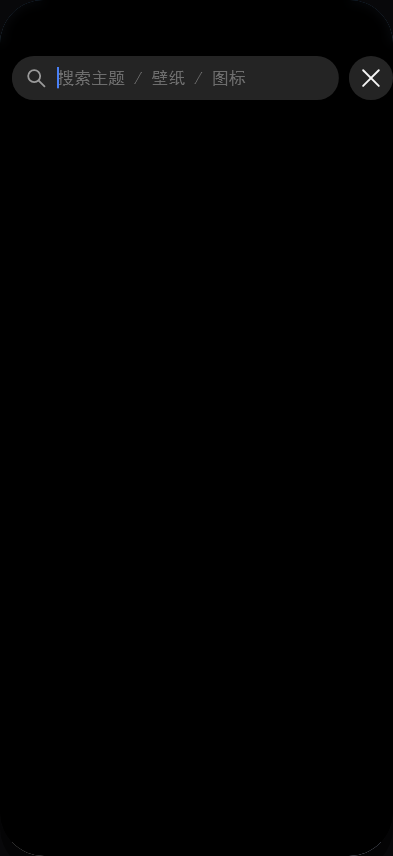

# mi_like_ui

小米风格可扩展 UI 组件框架（Flutter）。

以像素级实测还原小米系视觉与动效，沉淀为分层清晰、可持续扩充的组件库。
当前已落地 `MiGlassNavBar`（玻璃悬浮底部导航栏）、`MiGlassSideNavBar`
（同一套玻璃配方的**侧边**导航栏，桌面模式替身）、`MiPillTabBar`
（胶囊分类标签行）、`MiButton`（胶囊按钮）、`MiSearchBar`（搜索栏，
透明磨砂参数与导航栏同源）、`MiTopBar`（大标题折叠顶部导航栏，
渐进磨砂材质 + 逐帧实测折叠曲线）与 `MiThemeCard`（竖向预览卡片，
主题商店精选卡）；弹窗、表单等组件按同一组织方式逐步扩充。

## 效果

### 深色

 

### 浅色

 

### 组件：侧边导航栏（MiGlassSideNavBar，宽屏 / 桌面）

底部栏的**同语义纵向版**：外壳容器宽 **> 600dp**（`MiBreakpoints.navRail`，
判定口 `MiBreakpoints.usesSideNav(width)`）时把底部栏换成左侧悬浮侧栏；
手机竖屏 / 窄窗仍用底部栏。两者吃**同一份 `MiGlassNavItem`**（标签 + 图标
painter）、同一个 `selectedIndex` 与同一个 `onTap(index)`，选中态同为「胶囊
透镜」，所以图标、选中反馈与跳转行为一字不改。

判定逻辑照抄 MReader 主壳层（`lib/ui/home_shell.dart`）：
**`LayoutBuilder` 读外壳自己的 `constraints.maxWidth`，`> kShellRailBreakpoint`
（= 600）切侧栏**，严格大于 —— 正好 600 仍走底栏。所以**平板也用侧栏**
（600…1023 属宽屏档），只有手机留底栏；判据跟着容器走而不是跟着窗口走，
手机框被嵌进再宽的窗口也不会摆侧栏（示例：画面 393 → 底栏，720 / 1000 →
侧栏）。`MiBreakpoints.desktop`（1024）保留给「桌面档专属」的样式判断
（示例舞台加宽、网格 6/8 列），**不参与导航形态判定**。

玻璃配方、`BackdropFilter` 的 σ、飞行 / 弹性沉降 / 按压缩圈 / 拖拽吸附的曲线
与时长全部复用底部栏的 token（`MiGlassPalette`、`MiTransparencyTokens`、
`MiGlassNavMetrics`），只把**轴换成纵向**：飞行方向由 x 变 y，果冻形变由
「宽拉伸 + 高压缩」变「高拉伸 + 宽压缩」。几何值均为**推导（非实测）**——
参考素材里没有侧栏样张，故全部由底部栏已实测 token 换算（栏宽 = 一格 82.2 +
两侧内边距 6.6 = 95.4，条目高 = 胶囊高 49.3，图标墨盒 / 间距一字不改），
换算表见 `side_nav_bar_metrics.dart`。

**内外圈等距（2026-10-18 修订）**：栏体（外圈）圆角 = 内圈胶囊圆角 + 内边距
= 31.25dp —— 端头圆弧与胶囊顶角圆弧**同心**，内外圈间距四周恒 6.6dp。
初版取「全圆角 stadium」`railWidth / 2`（47.7）与内圈不同心：肩部间距会从
6.6 收缩到 0（两圆弧相交、胶囊顶角被裁），与底部栏「pill 端头与栏体端头同心、
间距恒 3.05」的等距原则相悖。

两处刻意差异：**圆钮（`fab`）挂在栏尾下方、栏体不让位**（底部栏的「栏体平移
让位」是为横向一排 tab 的居中腾挪；侧栏锚定左上，圆钮纵向排在栏体下方，间距 /
直径沿用底部栏实测 11.9 / 55.4，显隐契约与弹出曲线逐帧同源，槽位恒定预留、
显隐零布局跳动）；**栏体竖向收缩到内容高、贴顶摆放**（对应底部栏「栏宽 =
内容宽、位置由宿主给」的同构做法，示例贴顶 + 距左缘 25.5dp）。
示例的绿色圆钮在两种形态**共用同一份 `MiGlassNavFab` 声明**：仅「首页」选中时
弹出、切走收起。

形态切换是整棵子树替换、**不做淡入淡出**：`Opacity` / `AnimatedSwitcher` 会给
含 `BackdropFilter` 的子树引入 saveLayer，切换期间磨砂会整段消失（本项目实测
过的坑）。示例里页面恒为第一个 `Stack` 子级、只改左缘（0 → 侧栏列宽 120.9dp），
所以跨断点来回改窗口尺寸时页面的 `Element` 不重建、滚动位置不丢。

 

### 组件：胶囊分类标签行

 

### 组件：胶囊按钮（MiButton）

「我的关注」页关注按钮实测复刻（59.9×28.3dp stadium、#4980F7 明暗同色）；下图为 主 / 次级 / 禁用 三态：

 

### 组件：大标题折叠顶部导航栏（MiTopBar）

HyperOS 顶栏实测复刻（1220×2656 录屏逐帧反解）：大标题**属于滚动内容**
（质心位移与列表滚动逐帧相等），并另沿一条独立曲线淡出；紧凑标题在其归零后
（滚动 ≈20→27.4dp）才居中淡入，两段不重叠。标题用 `Baseline` 把基线钉到实测
反推的目标值（墨心 = 基线 − 0.355em），落点不随字体族的 ascent/descent 漂移。

材质是**磨砂 + 压色**，而磨砂有**两种形态两套实测规律**：

- **无头部区**（纯标题 / 纯材质）：**渐进磨砂** —— σ 从栏顶 5.37dp 向下衰减，
  到材质盒底完全锐利（实测曲线 119dp，按盒高等比拉伸到材质盒 128.9）。判据是
  没有顶栏的「每日精选」页：内容顶部照样糊、越往下越清楚、~120dp 自然收尾无硬边。
- **有头部区**（搜索栏 + 胶囊行）：**一整段恒定 σ = 5.37dp** 铺满整条栏
  （0…`occupiedHeight`），到栏底**硬切**回清晰。判据是首页亮/暗完整截图
  （881×1920）：搜索栏行、栏与胶囊之间的空隙、胶囊行后方的树影糊得**一样重**，
  胶囊底缘（实测 152dp）往下草地图案与「Simply Gorgeous」小字立刻锐利 ——
  若照渐进曲线拉伸到 156dp，胶囊行处只剩 σ≈2.5，与截图明显不符。恒定 σ 只要
  一段，顺带把这一档从 8 段全宽高斯压到 1 段。

压色是另一层：亮 #F3F3F3 @0.650→0，深色配方取自设置页、顶部不透明。
Flutter 没有"位置相关模糊"，而用半透明遮罩削弱模糊层会让 backdrop 失效（实测
`ShaderMask` / `Opacity` 都会让模糊整段消失），故用**分段定 σ 阶梯**近似：
8 段各 `ClipRect + BackdropFilter`，σ 取实测曲线在段中点的值（段高 ≤ 17dp、
相邻 σ 比 ≤ 1.5，台阶不可见）。判据是高频内容（头像照片 / 圆角方块的竖直边缘）
在栏内被抹开、且越往下越清楚；σ 由「边缘 10-90% 宽度」与「同行频谱比
log(S₁/S₀) = −2π²σ²f²」两种独立方法交叉验证。

`title` **可空**：不传即**纯材质形态**（不内嵌任何组件，只画磨砂 + 叠色）。
返回圆钮**默认不显示**：`showBack: true` 才绘制，其可点性再由 `onBack` 决定
（`null` = 只显示不可点）。内容首行顶缘按实测分两档：卡片类
`contentTopInset` 183dp、搜索栏类 `searchBarTopInset` 168.5dp。

除了标题，顶栏还能**内嵌头部区**（分类页就是这种形态），而且这部分**由顶栏
自己产出**：传 `searchHint` 顶栏内部就构造 `MiSearchBar`，传 `tabs` /
`selectedTab` / `onTabChanged` 就构造 `MiPillTabBar` —— 页面只给数据，不 new
组件、也不传 `themeMode`（明暗配方由顶栏统一解析后下发）。状态栏让位、左右
页边距、两者间距与左缘对齐全在顶栏里算。要换皮/塞别的组件时改用同名的
`searchBar` / `tabBar` 插槽，`header`（`PreferredSizeWidget`）是整块自定义头部
的逃生口（`header` 与搜索栏 / 胶囊行互斥，`searchBar`↔`searchHint`、
`tabBar`↔`tabs` 各自互斥，均构造期断言）。高度是**声明值**，顶栏据此排版、
宿主用 `bar.occupiedHeight(context)` 给滚动内容让位 —— 同一套数字，不会出现
「头部下移而列表没让位」。

**材质拆成两个开关，都不属于「顶栏」本身**。参考 App 有一页**完全没有顶栏**
（主题商店「每日精选」），内容顶部照样是糊的、且越往下越清晰，到 ~120dp 自然
收尾 —— 所以磨砂其实是**内容滚动区自己的顶部渐进模糊**（已抽成独立组件
`MiGradientBlur`，见下一节），只是位置正好落在顶栏下面：

- `showBlur`（默认开）：磨砂。无头部区是 σ 沿 y 递减到材质盒底归零（渐进、
  无硬边）；有头部区是一整段恒定 σ 铺满整条栏、栏底硬切（见上）。内置的
  搜索栏 / 胶囊行随之关掉自绘的 backdrop（`frosted: false`）—— 整条栏只糊一次。
- `showSurface`（默认开）：顶部最深的**压色**，保证大标题可读。分类页那页
  实测没有这层压色（整条栏都能看见被模糊的背景），故传 `false`。

两个都传给 `false` 才回到「零件各自玻璃」的旧形态。

**搜索态**由两个入参驱动：`searchActive`（宿主置 true）+ `onSearchCancel`（点取消
钮回来）。打开后内置搜索栏换成真 `TextField`（`editable: true`）、右侧让位出取消
钮、胶囊行淡出并退出排版 —— 见后面「搜索态」一节。

下图每格分别是：① 纯材质形态（标题不传，滚动 96dp → 头像滑进栏内被抹开）、
② 顶层页（无圆钮、首行搜索栏 168.5dp）、③ 次级页（带圆钮、首行卡片 183dp）、
④ 滚动 105dp（紧凑标题浮现、内容穿进磨砂）：

 

### 组件：顶部渐进模糊（MiGradientBlur）

那层"内容顶部被糊开、越往下越清楚"的效果，**不是顶栏的一部分** —— 单独抽成
`MiGradientBlur`，任何滚动内容都能自己挂一层，不必有顶栏：

```dart
Stack(children: [
  ListView(children: [...]),
  Positioned(top: 0, left: 0, right: 0, height: 120,
    child: MiGradientBlur(height: 120)),   // 120dp 内从 σ5.37 衰减到 0
])
```

`height` 是作用区高度，曲线**形状固定、范围跟着它走**（119dp 的实测曲线等比
拉伸到 `height` 归零，区底不留硬边）。上层若盖了不透明压色，传
`opaqueScrimBottom` + `underSurface: true` 可跳过被 100% 遮住的段（零视觉差异
的省帧；**关掉压色时务必传 `underSurface: false`**）。`MiTopBar(showBlur: true)`
内部就是复用它，几何与曲线完全同源。

### 组件：主题卡片（MiThemeCard）

主题商店「精选主题」卡实测复刻（881×1920 首页截图）：预览图按 259:472 定比 +
`radiusLg` 20dp 圆角（外缘拟合 R=44px），标题 13.85dp Medium、较图左缘内缩
8.8dp 与区块标题同列起排；下图为 3 列实测壁纸主色渐变占位：

 

「分类」tab 为组件展示页（「Logo 展示」组前 6 位为 `nav_icons.dart` 全量 logo，「按钮展示」组陈列 `MiButton` 三态，其余为示例占位；标签行吸顶）：

 

卷起来看吸顶头部（滚动 150dp）：网格从搜索栏 / 胶囊行后方经过，整条头部区在
**同一块均匀磨砂**下一起被磨开，到栏底切回清晰 —— 搜索栏、胶囊行与它们之间
的空隙不再是「各自一块玻璃、中间夹着锐利内容」。同时零件自带那层玻璃膜生效：
色块透上来会被压成一档暗玻璃片（见下方「玻璃膜」），静止态则因为膜取的就是
页底色、垫在同色页底上等于没垫，观感与不开时一致：

 

### 组件：弹框（MiDialog）

MIUI 系统弹框实测复刻（两张参考图各含亮/暗：联系人「删除联系人」、主题商店
「删除1项资源」）：遮罩 + 卡片一体的全屏浮层，卡片宽 369.2 / 圆角 49.3 / 底缘
距屏 32.9dp，标题 18.0、正文与按钮标签 15.9dp，按钮高 49.9、圆角 15.0、行内缩
24.2、按钮间距 12.6；卡片高随正文行数走（双行实测 207.1dp，行距 23.2）。
标题 / 正文 / 按钮标签的**墨心落点由 `Baseline` 钉死**（0.355em 规则，
`MiDialogMetrics`），与顶栏标题同一套跨字体稳定做法。按钮三种形态（`MiDialogActionStyle`）：
中性「取消」、主按钮蓝填充「确定」、破坏性红字「删除」。

位置三档（`MiDialogPosition`，**默认底部**）：底部为实测档；顶部为镜像推导
（以安全区兜底让开状态栏）、居中为垂直居中推导。遮罩实测亮 = 黑 @0.20、
暗 = 黑 @0.60（白页底→#CCCCCC 反解；同缩略图暗/亮透射比恒 0.500 交叉验证）。

> 两个参考弹框的 builder 并不完全一致（正文对齐 start / center、整块文字差
> 2.4dp），组件按**联系人弹框**（原生分辨率）一条节奏走到底，正文对齐做成参数
> `messageAlign`（默认居中）。

底部档（默认）——左「删除联系人」复刻（正文 start、红字删除），右「删除1项资源」
复刻（正文居中、蓝底确定）：

   

顶部 / 居中（推导档，同「删除联系人」弹框平移）：

   

「我的」页有三档位置的演示入口（点按弹出、遮罩或按钮点按收起）。

### 首页：悬浮搜索栏 + 胶囊行的磨砂

首页改成参考图的形态：**高频横幅从屏顶铺到 186dp**（含状态栏后面），搜索栏与
胶囊行悬浮其上，列表**不给自己留头部让位** —— 横幅和下面的区块一起从头部后方
滚过，那条恒定 σ 的整栏磨砂才有东西可糊。静止态就能看到分界：横幅上半段（0…156dp）
被抹开，156dp 往下草地图案立刻锐利。

横幅是程序化绘制的风景（`_HeroPainter`：天空 / 远山 / 树线剪影 / 随机草叶），
因为**平坦色块在模糊下亮度不变**，渐变色块判不了"有没有糊" —— 必须有高频纹理
才能看出磨砂。下图上排静止、下排上滚 20dp（草叶整片压到搜索栏与胶囊行后方）：

   

> 预览图由 `test/preview_capture_test.dart` 生成，样式变更后重新执行
> `flutter test --update-goldens test/preview_capture_test.dart` 刷新。

**压在内容上的零件要另铺一层「玻璃膜」**（`overContent: true`）：光有磨砂不够 ——
模糊只改局部对比、不改局部均值，实测胶囊内侧比同 y 间隙亮 33 级（亮）/ 暗 100 级
（暗），那层落差只能来自膜本身。膜**垫在低调填充之下**，两层预合成成一个等效色
（`MiTransparencyTokens.veiledFill`）：膜取的就是页底色，垫在同色页底上等于没垫，
所以平底/静止态观感不变、只有内容滚到头部后面才显出玻璃片 —— 首页与分类页都开着，
不需要跟着滚动状态翻转。取值与推导见 `MiTransparencyTokens.veilAlpha*`。

### 搜索态：点搜索栏 → 输入

点首页的搜索栏即进入搜索态（参考「短信」搜索录屏 592×1280 @24fps 实测）：

* 搜索栏**变成真输入框** —— 放大镜与占位文字都不动，左侧多一条**闪烁光标**
  （亮 500ms / 灭 500ms，与 Flutter 默认半周期一致），聚焦即弹键盘；
* 右侧淡入**取消钮**（`MiSearchCancelButton`，⌀44.1 = 栏高），搜索栏同时右缘
  左移让位（间隙 10.0）；
* 胶囊行淡出、退出排版 —— 顶栏的 `occupiedHeight` 从 156 收到 100.1。

转场 **480ms**（起手静止 48ms + 位移 430ms 的 `easeOutQuint`），拟合自逐帧位移
`252 244 194 143 112 95 86 82 80 79 79 78`（px）；取消钮的淡入**不与位移同步**，
落在 35%…62% 那一段（实测 208 / 250 / 292ms 时覆盖率 0.32 / 0.63 / 0.96）。

 

> 参考录屏那页正常态搜索栏在大标题下方（168.4dp），点按后升到状态栏下方
> （52.1dp），Δ = 116.3dp。本库的头部区一直是钉在状态栏下方、没有「标题 +
> 头部区」同页形态，所以示例页这一段位移为 **0** —— 真正变化的是宽度让位、
> 取消钮、输入态与内容清空。

示例外壳在搜索态还有两条行为（2026-10-20 真机反馈）：

- **浮动底栏收起**：搜索是「专注输入」，底栏留在屏幕上会和键盘 / 取消钮抢注意力
  （参考录屏里也没有）。示例外壳用 `onSearchActiveChanged` 把搜索态上传，切底栏
  走**换结构**（`else if (!_searchActive)`）而不是 `Opacity` 淡出 —— 淡出会给含
  `BackdropFilter` 的子树套一层 `saveLayer`，backdrop 变空、玻璃栏瞬间变锐利
  （本项目既有结论）。
- **键盘覆盖、画面不缩放**：`Scaffold(resizeToAvoidBottomInset: false)`。`DemoStage`
  是按**可用高度**取 `min(1, w/W, h/H)` 的等比画布，`viewInsets` 一吃高度整块画面
  就跟着缩水（真机实拍：底栏连同整页一起被顶扁）。关掉后键盘盖住下半屏，画布尺寸
  恒定不变 —— 这也是全屏 App 里键盘的标准行为。



### 自适应（响应式）

框架层 `src/utils/responsive.dart` 提供断点判定与等比缩放画布，示例层
`DemoStage` 用它们把「画面」摆进任意窗口。**三处断点各管一件事**：

| 档位 | 窗口逻辑宽 | 示例外壳（`DemoStage`） | 内容网格列数（主题卡 / 展示位） | 导航形态 |
|---|---|---|---|---|
| compact | < 600dp | **物理手机画布** 393×856，等比缩到放得下（手机全屏时正好 1:1、零留白） | 3 / 4 | 底部栏（画面 393 ≤ 600） |
| medium | 600…1023dp | **铺满窗口**（edge-to-edge，画面 = 窗口，无外边距 / 无圆角卡片） | 4 / 6 | **侧栏**（画面 > 600） |
| expanded | ≥ 1024dp | 同上，铺满窗口 | 6 / 8 | **侧栏**（页面让出 120.9dp 列宽） |

> **大屏为什么不再做「背景 + 圆角卡片」**：那圈留白和圆角是模拟手机外壳的产物，
> 平板/桌面上它既不是 UI 的一部分，还会让状态栏那一条与页面底色对不上 ——
> 2026-10-18 平板实拍反馈「应该铺满屏幕，不需要外围卡片效果」。现在只有 compact
> 档是「物理手机」（圆角 44 + 投影），平板/桌面就是真实 App 的样子。
>
> 铺满还要求**边到边（edge-to-edge）**：`main.dart` 里 `SystemUiMode.edgeToEdge`
> + 透明的状态栏 / 手势条，`DemoHome` 用 `AnnotatedRegion<SystemUiOverlayStyle>`
> 让状态栏图标随明暗翻转。否则应用窗口从状态栏下方开始，那条状态栏是**系统自己
> 画的底色 + 压色**，看起来就是一条灰带（同一批实拍的另一半成因）。代价是浮层要
> 自己让安全区：顶栏读 `MediaQuery.padding.top`，侧栏顶 = `padding.top + 25.5`，
> 底栏底 = `max(24.2, padding.bottom)`。**底栏那档不叠加**：24.2 本来就是距屏幕
> 物理底缘的实测值，系统手势条正落在这 24.2 之内，叠加会把栏顶到 45dp、条悬在
> 空档里；只有三键导航（48dp）这种比 24.2 还大的安全区才抬起来。
> 画面里那条 Home 指示条**由系统自己画**，示例不再自绘（自绘一条 + 系统一条 =
> 真机两条，2026-10-20 反馈）。

- **窗口断点**（`MiViewport` / `MiBreakpoints.ofWidth`）决定外壳是否把画面加宽；
  **容器断点** `MiBreakpoints.usesSideNav(width)`（示例传画面的
  `LayoutBuilder` 约束宽，`> 600` 切侧栏）决定**导航形态**；
  **内容断点**（`MiResponsiveGrid.compactMax / mediumMax`，示例取 520 / 800）
  决定网格列数 —— 三者判据不同源，混用会出错：限宽画布里的容器永远够不到
  窗口断点（混用会让宽屏换不到列），而导航形态必须跟着容器走（手机框嵌进
  宽窗口不该摆侧栏）。页面让出侧栏列宽后内容变窄，网格按**新的容器宽**自行重排。
- **只缩不放、宽高同比例**：`MiScaledCanvas.scaleFor` 取
  `min(1, 可用宽/设计宽, 可用高/设计高)` → 不溢出、不变形；`scale == 1` 时走
  原样路径、不加任何变换层（黄金图逐像素稳定），缩小走 `FittedBox` 矢量重绘。
- **实时响应**：`MediaQuery.sizeOf` + `LayoutBuilder` 依赖注入，窗口/分屏/浏览器
  缩放一变即重排，不需要 `setState` 或尺寸监听。
- **不丢内容**：网格行内 `Expanded` 等分、末行留空不拉伸；长文案一律
  `maxLines: 1 + ellipsis`；分类页胶囊行显式左对齐（否则宽屏会被 `Column`
  默认居中、与搜索框/网格左缘失配）。

验证：`test/responsive_test.dart` —— 断点边界、`scaleFor` 纯函数、三档外壳尺寸
（平板/桌面 = 窗口尺寸）、260×470 小窗与 1366×768 桌面端的实际渲染（无溢出 +
关键部件在窗口内 + 宽高比不变）、窗口尺寸热切换、网格 3/4/6 与 4/6/8 列；
`test/desktop_nav_test.dart` —— `usesSideNav` 严格大于 600（600 底栏 / 601 侧栏）、
侧栏几何与选中槽位、点按与拖拽回调、断点两侧形态唯一、铺满（圆角 0 / 无投影）、
透明状态栏与图标亮度随主题翻转、侧栏让开状态栏 / 底栏在手势条之上（不叠加安全区）
且画面不自绘 Home 指示条、跨断点来回切换保留滚动位置。

   

桌面浅色（侧栏玻璃体与投影落在浅底上，无拼接缝）：


## 性能：每帧模糊预算

磨砂是这个框架最贵的绘制：`BackdropFilter` 每帧都要对 backdrop 重算一次
**全 QUAD 高斯**，滚动时 backdrop 一变就得重来。滚动掉帧基本都出在这里，
所以把「一次 build 里的模糊层数 + 覆盖面积（dp²，与 dpr 无关）」钉成预算
（`test/perf_budget_test.dart`）：

| 形态（深色） | 层数 / 覆盖面积 |
|---|---|
| 手机 393×856（底栏 + 顶栏 + 搜索栏） | 7 层 / 52,081 dp² |
| 平板 768×1280（铺满 + 侧栏；页面列 647.1） | 首页 7 / 78,562 · 我的 6 / 52,142 · 分类 8 / 109,360 |
| 桌面 1366×768（铺满 + 侧栏；页面列 1245.1） | 首页 7 / 137,506 · 分类 8 / 194,809 |

换侧栏**不是**多加磨砂换来的：页面列变窄、侧栏自己只挂 1 层
（95.4 × 177.1 = 16,896 dp²），层数与底栏时代同量级（优化前同一页
10 层 / 100,073 dp²）。**面积**则随宽度线性增长 —— 铺满窗口后桌面顶栏每段都
跟着变宽（1366 宽时首页 137,506 dp²），这是 edge-to-edge 的必然代价。

三条**零视觉差异**的优化（逐像素对比：最大灰度差 1~2 级，无任何像素差 > 2）：

1. **顶栏跳过被不透明叠色盖住的模糊段**：深色配方 0…63.6dp 的叠色是
   α = 1.000 纯黑，其下的模糊结果 100% 看不见 —— 8 段 / 119dp 降到 5 段 /
   45.4dp（`MiTopBar.visibleBlurBands`）。亮色叠色顶部只有 α 0.650，一段不省。
2. **胶囊行 4 个 BackdropFilter 合并成 1 个**：一次 `ClipPath` 裁出全部胶囊形状
   + 单个 backdrop 模糊（旧实现每个胶囊各一次高斯 + 一个 saveLayer）。相邻
   胶囊仍不串色 —— 模糊层先于所有填充绘制。
3. **σ 固定的 `ImageFilter` 缓存复用**（`src/utils/filter_cache.dart`）：避免每帧
   新建 native filter；另外 σ < 0.5dp 的段（高斯半径 < 1dp，亚像素）不绘制。

还有一个**交互层**的修正：切 tab 去掉了 260ms 淡入淡出。`FadeTransition` 会给
整页套 `Opacity` → 引入 saveLayer，而 saveLayer 会让下层 `BackdropFilter` 的
backdrop 变空（本项目实测过的坑）—— 切页期间旧页磨砂会消失、还多算一份全宽
高斯（实测模糊层 7 → 9、另有 6 层 opacity）。底部 tab 惯例本就是瞬时切换。

**验证方式**（务必在 profile 下看，debug 模式的渲染开销是 profile 的几倍，
「感觉丢帧」多半来自 debug 运行）：

```bash
flutter run --profile                       # 运行后按 P 打开性能 overlay
adb shell dumpsys gfxinfo com.example.bottom_nav_demo reset
# … 在应用里连续滚动 / 切 tab 约 20 秒 …
adb shell dumpsys gfxinfo com.example.bottom_nav_demo | Select-String "Janky frames"
```

## 设计原则
- **实测优先** — 视觉与动效参数以像素测量值为准，黄金图回归锁行为
- **组件自包含** — widget / 参数 / 绘制同目录组织，互不泄漏
- **token 驱动** — 颜色、文字、间距、材质统一走主题层，组件内不写字面量
- **API 最小暴露** — 只经 barrel 导出，内部实现可自由演进

## 架构

```
lib/
├── mi_like_ui.dart          # 入口导出层（barrel，唯一对外 API）
├── main.dart                # demo 引导
├── demo/                    # 示例层（演示 app）
└── src/
    ├── theme/               # 样式/主题层（颜色·文字·间距·材质·透明/磨砂 token，明暗双配方）
    ├── components/          # 组件层（类别/组件名/ 两级目录）
    │   ├── navigation/
    │   │   ├── glass_nav_bar/
    │   │   ├── glass_side_nav_bar/
    │   │   ├── pill_tab_bar/
    │   │   └── top_bar/
    │   ├── buttons/
    │   │   └── button/
    │   ├── inputs/
    │   │   └── search_bar/
    │   └── cards/
    │       └── theme_card/
    ├── icons/               # nav_icons.dart：导航栏 logo 合集（含加号 logo）
    └── utils/               # 工具函数层（纯函数 + 断点/缩放/响应式网格）

test/                        # 黄金图 + 交互测试
```

| 层 | 职责 |
|---|---|
| 导出层 `lib/mi_like_ui.dart` | 唯一对外 API 面 |
| 组件层 `src/components/` | 可复用组件：widget + metrics + painter |
| 主题层 `src/theme/` | 跨组件样式 token；**透明/磨砂参数统一在 `transparency_tokens.dart`**，其余 token 只引用 |
| 图标 `src/icons/nav_icons.dart` | 导航栏 logo 合集（`*IconPainter`） |
| 工具层 `src/utils/` | 无状态纯函数 |
| 示例层 `lib/demo/` | 演示 app，模拟真实使用方 |

## 约定

- 公共类 `Mi` 前缀（`MiGlassNavBar`、`MiColors`）；图标 painter 用 `*IconPainter`
- 文件名 snake_case 取事物名；组件常量进 `<组件名>_metrics.dart`
- 使用方与测试只 import barrel；未导出的 `src/` 实现即内部，不承诺 API 稳定
- **透明参数只有一个来源** —— `src/theme/transparency_tokens.dart`（blur σ、
  各级填充 alpha、玻璃膜色、顶栏压色曲线的采样色、玻璃导航栏各层 alpha）。
  其它 theme 文件与组件**只引用常量**，不写字面量：`withOpacity` / `fromRGBO`
  的 alpha 位 / 带 alpha 的十六进制色，都由 `test/transparency_config_test.dart`
  扫源码守门（还有一条「配置文件自身必须带字面量」防止规则空转）
  - alpha 用 0-255 字节（`Color.fromARGB`）还是 double（`Color.fromRGBO`）看实测
    口径：录屏反解出的 0.63 / 0.094 保留 double，避免 0.63 → 161/255 的取整偏差
    让黄金图漂移
  - 顶栏压色 / 渐进曲线这类**曲线**：色值表在统一配置（`scrimGradientDark` /
    `scrimGradientLight` / `blurSigmaRamp`），组件 token 只保留几何（stops、
    段位与段高）

## 扩充新组件

1. `src/components/<类别>/<组件名>/` 建目录（widget / metrics / painter）
2. 样式取主题层 token，缺则先补 token
3. barrel 补一行 `export`
4. 测试与 demo 各补一例
5. `flutter analyze` + `flutter test` 全绿后提交

## 开发

```bash
flutter run      # 运行演示
flutter test     # 回归测试
```

## 路线图

- [x] `MiGlassNavBar` — 玻璃悬浮底部导航栏
- [x] `MiGlassSideNavBar` — 玻璃悬浮侧边导航栏（桌面模式，与底部栏同语义/同配方）
- [x] `MiPillTabBar` — 胶囊分类标签行
- [x] `MiButton` — 按钮
- [x] `MiSearchBar` — 搜索栏（与导航栏共用透明磨砂参数）
- [x] `MiTopBar` — 大标题折叠顶部导航栏（渐进磨砂材质）
- [x] `MiThemeCard` — 竖向预览卡片（主题商店精选卡）
- [x] `MiScaledCanvas` / `MiResponsiveGrid` / `MiViewport` — 断点与等比缩放（桌面/平板/手机自适应）
- [ ] `MiDialog` — 弹窗
- [ ] `MiForm` — 表单
- [ ] `MiTheme` — 主题聚合
