# mi_like_ui

小米风格可扩展 UI 组件框架（Flutter）。

以像素级实测还原小米系视觉与动效，沉淀为分层清晰、可持续扩充的组件库。
当前已落地 `MiGlassNavBar`（玻璃悬浮底部导航栏）、`MiGlassSideNavBar`
（同一套玻璃配方的**侧边**导航栏，桌面模式替身）、`MiPillTabBar`
（胶囊分类标签行）、`MiButton`（胶囊按钮）、`MiSearchBar`（搜索栏，
透明磨砂参数与导航栏同源）、`MiTopBar`（大标题折叠顶部导航栏，
渐进磨砂材质 + 逐帧实测折叠曲线）与 `MiThemeCard`（竖向预览卡片，
主题商店精选卡）；弹窗、表单等组件按同一组织方式逐步扩充。

## 效果

### 深色

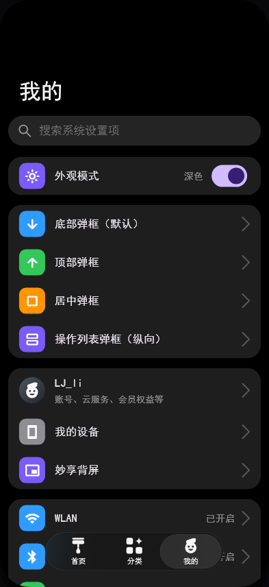 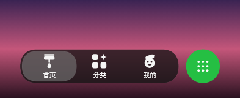

### 浅色

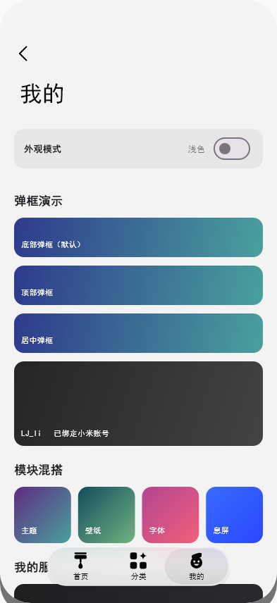 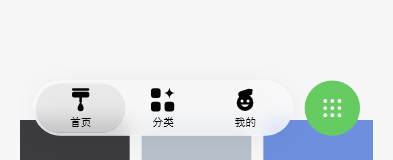

### 组件：侧边导航栏（MiGlassSideNavBar，宽屏 / 桌面）

底部栏的**同语义纵向版**：外壳容器宽 **> 600dp**（`MiBreakpoints.navRail`，
判定口 `MiBreakpoints.usesSideNav(width)`）时把底部栏换成左侧悬浮侧栏；
手机竖屏 / 窄窗仍用底部栏。两者吃**同一份 `MiGlassNavItem`**（标签 + 图标
painter）、同一个 `selectedIndex` 与同一个 `onTap(index)`，选中态同为「胶囊
透镜」，所以图标、选中反馈与跳转行为一字不改。

判定逻辑照抄 MReader 主壳层（`lib/ui/home_shell.dart`）：
**`LayoutBuilder` 读外壳自己的 `constraints.maxWidth`，`> kShellRailBreakpoint`
（= 600）切侧栏**，严格大于 —— 正好 600 仍走底栏。所以**平板也用侧栏**
（600…1023 属宽屏档），只有手机留底栏；判据跟着容器走而不是跟着窗口走，
手机框被嵌进再宽的窗口也不会摆侧栏（示例：画面 393 → 底栏，720 / 1000 →
侧栏）。`MiBreakpoints.desktop`（1024）保留给「桌面档专属」的样式判断
（示例舞台加宽、网格 6/8 列），**不参与导航形态判定**。

玻璃配方、`BackdropFilter` 的 σ、飞行 / 弹性沉降 / 按压缩圈 / 拖拽吸附的曲线
与时长全部复用底部栏的 token（`MiGlassPalette`、`MiTransparencyTokens`、
`MiGlassNavMetrics`），只把**轴换成纵向**：飞行方向由 x 变 y，果冻形变由
「宽拉伸 + 高压缩」变「高拉伸 + 宽压缩」。几何值均为**推导（非实测）**——
参考素材里没有侧栏样张，故全部由底部栏已实测 token 换算（栏宽 = 一格 82.2 +
两侧内边距 6.6 = 95.4，条目高 = 胶囊高 49.3，图标墨盒 / 间距一字不改），
换算表见 `side_nav_bar_metrics.dart`。

两处刻意差异：**不做预留空位圆钮**（那套「栏体平移让位」是横向一排 tab 的
空位腾挪，侧栏无等价语义）；**栏体竖向收缩到内容高、贴顶摆放**（对应底部栏
「栏宽 = 内容宽、位置由宿主给」的同构做法，示例贴顶 + 距左缘 25.5dp）。

形态切换是整棵子树替换、**不做淡入淡出**：`Opacity` / `AnimatedSwitcher` 会给
含 `BackdropFilter` 的子树引入 saveLayer，切换期间磨砂会整段消失（本项目实测
过的坑）。示例里页面恒为第一个 `Stack` 子级、只改左缘（0 → 侧栏列宽 120.9dp），
所以跨断点来回改窗口尺寸时页面的 `Element` 不重建、滚动位置不丢。

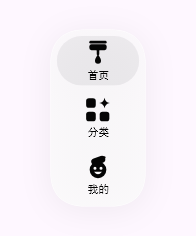 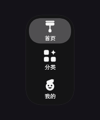

### 组件：胶囊分类标签行

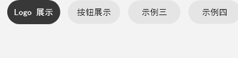 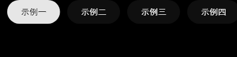

### 组件：胶囊按钮（MiButton）

「我的关注」页关注按钮实测复刻（59.9×28.3dp stadium、#4980F7 明暗同色）；下图为 主 / 次级 / 禁用 三态：

 

### 组件：大标题折叠顶部导航栏（MiTopBar）

HyperOS 顶栏实测复刻（1220×2656 录屏逐帧反解）：大标题**属于滚动内容**
（质心位移与列表滚动逐帧相等），并另沿一条独立曲线淡出；紧凑标题在其归零后
（滚动 ≈20→27.4dp）才居中淡入，两段不重叠。标题用 `Baseline` 把基线钉到实测
反推的目标值（墨心 = 基线 − 0.355em），落点不随字体族的 ascent/descent 漂移。

材质是**渐进磨砂**：backdrop 模糊从栏顶的 σ = 5.37dp 向下衰减，到 119dp 处完全
锐利，再叠一层页底色（亮 #F3F3F3 @0.650→0，深色配方取自设置页、顶部不透明）。
Flutter 没有"位置相关模糊"，而用半透明遮罩削弱模糊层会让 backdrop 失效（实测
`ShaderMask` / `Opacity` 都会让模糊整段消失），故用**分段定 σ 阶梯**近似：
8 段各 `ClipRect + BackdropFilter`，σ 取实测曲线在段中点的值（段高 ≤ 17dp、
相邻 σ 比 ≤ 1.5，台阶不可见）。判据是高频内容（头像照片 / 圆角方块的竖直边缘）
在栏内被抹开、且越往下越清楚；σ 由「边缘 10-90% 宽度」与「同行频谱比
log(S₁/S₀) = −2π²σ²f²」两种独立方法交叉验证。

`title` **可空**：不传即**纯材质形态**（不内嵌任何组件，只画磨砂 + 叠色）。
返回圆钮**默认不显示**：`showBack: true` 才绘制，其可点性再由 `onBack` 决定
（`null` = 只显示不可点）。内容首行顶缘按实测分两档：卡片类
`contentTopInset` 183dp、搜索栏类 `searchBarTopInset` 168.5dp。

除了标题，顶栏还能**内嵌头部区**（分类页就是这种形态），而且这部分**由顶栏
自己产出**：传 `searchHint` 顶栏内部就构造 `MiSearchBar`，传 `tabs` /
`selectedTab` / `onTabChanged` 就构造 `MiPillTabBar` —— 页面只给数据，不 new
组件、也不传 `themeMode`（明暗配方由顶栏统一解析后下发）。状态栏让位、左右
页边距、两者间距与左缘对齐全在顶栏里算。要换皮/塞别的组件时改用同名的
`searchBar` / `tabBar` 插槽，`header`（`PreferredSizeWidget`）是整块自定义头部
的逃生口（`header` 与搜索栏 / 胶囊行互斥，`searchBar`↔`searchHint`、
`tabBar`↔`tabs` 各自互斥，均构造期断言）。高度是**声明值**，顶栏据此排版、
宿主用 `bar.occupiedHeight(context)` 给滚动内容让位 —— 同一套数字，不会出现
「头部下移而列表没让位」。

**材质拆成两个开关，都不属于「顶栏」本身**。参考 App 有一页**完全没有顶栏**
（主题商店「每日精选」），内容顶部照样是糊的、且越往下越清晰，到 ~120dp 自然
收尾 —— 所以磨砂其实是**内容滚动区自己的顶部渐进模糊**，只是位置正好落在顶栏
下面：

- `showBlur`（默认开）：σ 沿 y 从 5.37dp 递减到**栏底归零**。曲线形状固定、
  范围跟栏高走（无头部区拉到材质盒 128.9dp，头部区形态拉到整条栏 156dp），
  栏底既不糊也不留硬边。内置的搜索栏 / 胶囊行随之关掉自绘的 backdrop
  （`frosted: false`）—— 整条栏只糊一次。
- `showSurface`（默认开）：顶部最深的**压色**，保证大标题可读。分类页那页
  实测没有这层压色（整条栏都能看见被模糊的背景），故传 `false`。

两个都传给 `false` 才回到「零件各自玻璃」的旧形态。

下图每格分别是：① 纯材质形态（标题不传，滚动 96dp → 头像滑进栏内被抹开）、
② 顶层页（无圆钮、首行搜索栏 168.5dp）、③ 次级页（带圆钮、首行卡片 183dp）、
④ 滚动 105dp（紧凑标题浮现、内容穿进磨砂）：

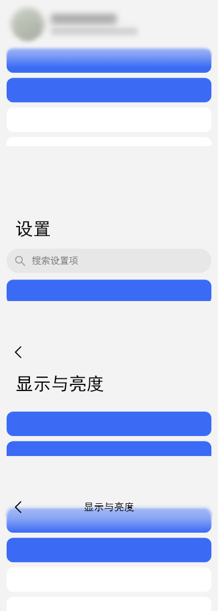 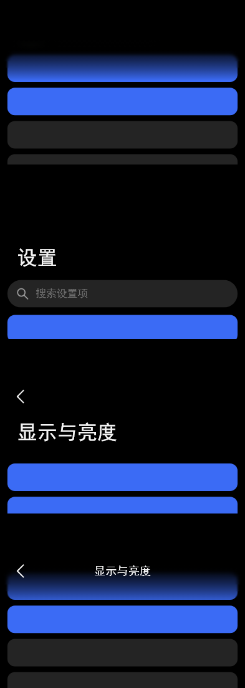

### 组件：主题卡片（MiThemeCard）

主题商店「精选主题」卡实测复刻（881×1920 首页截图）：预览图按 259:472 定比 +
`radiusLg` 20dp 圆角（外缘拟合 R=44px），标题 13.85dp Medium、较图左缘内缩
8.8dp 与区块标题同列起排；下图为 3 列实测壁纸主色渐变占位：

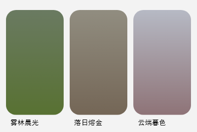 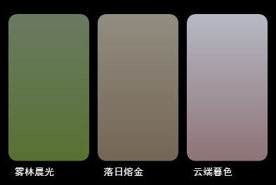

「分类」tab 为组件展示页（「Logo 展示」组前 6 位为 `nav_icons.dart` 全量 logo，「按钮展示」组陈列 `MiButton` 三态，其余为示例占位；标签行吸顶）：

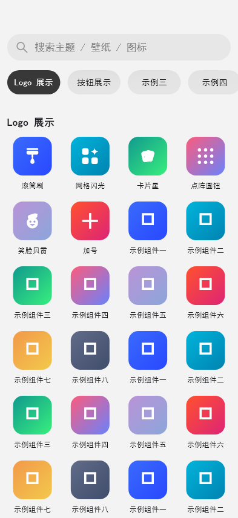 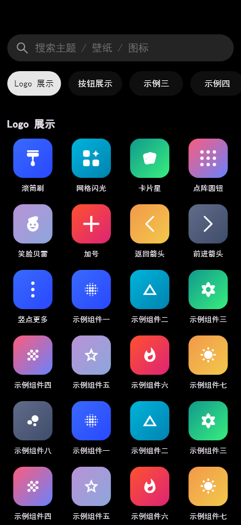

卷起来看吸顶头部（滚动 150dp）：网格从搜索栏 / 胶囊行后方经过，整条头部区在
**同一块均匀磨砂**下一起被磨开，到栏底切回清晰 —— 搜索栏、胶囊行与它们之间
的空隙不再是「各自一块玻璃、中间夹着锐利内容」：

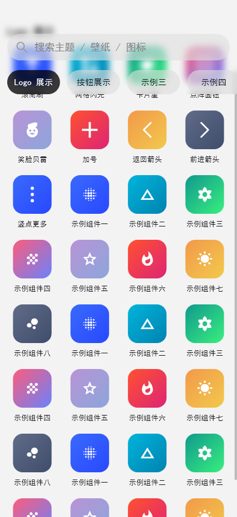 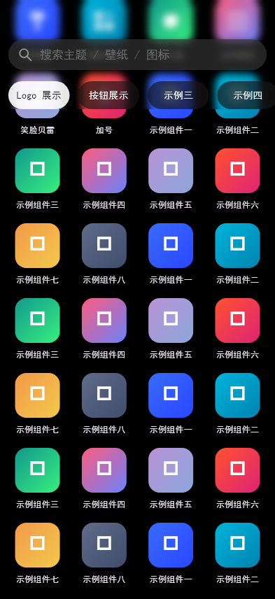

> 预览图由 `test/preview_capture_test.dart` 生成，样式变更后重新执行
> `flutter test --update-goldens test/preview_capture_test.dart` 刷新。

### 自适应（响应式）

框架层 `src/utils/responsive.dart` 提供断点判定与等比缩放画布，示例层
`DemoStage` 用它们把「物理手机画面」摆进任意窗口。**两级断点**分工明确：

| 档位 | 窗口逻辑宽 | 示例外壳（`DemoStage`） | 内容网格列数（主题卡 / 展示位） | 导航形态 |
|---|---|---|---|---|
| compact | < 600dp | 393×856 设计画布**等比缩小**到放得下（手机全屏时正好 1:1、零留白） | 3 / 4 | 底部栏（画面 393 ≤ 600） |
| medium | 600…1023dp | 画面**铺成内容舞台**（宽 = 可用宽、高 = 可用高，四周 24dp） | 4 / 6 | **侧栏**（画面 > 600） |
| expanded | ≥ 1024dp | 同上，宽度上限 1000dp（桌面端不让内容无限拉宽） | 6 / 8 | **侧栏**（页面让出 120.9dp 列宽） |

> 平板不再是一个 1x 居中的小手机：medium 档也铺成内容舞台，内容宽随屏幕增大，
> 网格从 3 列升到 4 列 —— 是**重新布局**，而不是把手机画面等比拉大（拉大后
> 1dp 实测值会失去物理意义）。2026-10-17 平板实机反馈：旧策略下 650×1138 的
> 屏幕里手机框只占 64% 高、上下各留 170/240px 纯黑。

- **窗口断点**（`MiViewport` / `MiBreakpoints.ofWidth`）决定外壳是否把画面加宽；
  **容器断点** `MiBreakpoints.usesSideNav(width)`（示例传画面的
  `LayoutBuilder` 约束宽，`> 600` 切侧栏）决定**导航形态**；
  **内容断点**（`MiResponsiveGrid.compactMax / mediumMax`，示例取 520 / 800）
  决定网格列数 —— 三者判据不同源，混用会出错：限宽画布里的容器永远够不到
  窗口断点（混用会让宽屏换不到列），而导航形态必须跟着容器走（手机框嵌进
  宽窗口不该摆侧栏）。页面让出侧栏列宽后内容变窄，网格按**新的容器宽**自行重排。
- **只缩不放、宽高同比例**：`MiScaledCanvas.scaleFor` 取
  `min(1, 可用宽/设计宽, 可用高/设计高)` → 不溢出、不变形；`scale == 1` 时走
  原样路径、不加任何变换层（黄金图逐像素稳定），缩小走 `FittedBox` 矢量重绘。
- **实时响应**：`MediaQuery.sizeOf` + `LayoutBuilder` 依赖注入，窗口/分屏/浏览器
  缩放一变即重排，不需要 `setState` 或尺寸监听。
- **不丢内容**：网格行内 `Expanded` 等分、末行留空不拉伸；长文案一律
  `maxLines: 1 + ellipsis`；分类页胶囊行显式左对齐（否则宽屏会被 `Column`
  默认居中、与搜索框/网格左缘失配）。

验证：`test/responsive_test.dart` —— 断点边界、`scaleFor` 纯函数、三档外壳尺寸、
260×470 小窗与 1366×768 桌面端的实际渲染（无溢出 + 关键部件在窗口内 + 宽高比
不变）、窗口尺寸热切换、网格 3/4/6 与 4/6/8 列；`test/desktop_nav_test.dart` ——
`usesSideNav` 严格大于 600（600 底栏 / 602 侧栏）、侧栏几何与选中槽位、点按与
拖拽回调、断点两侧形态唯一、画面让位与贴顶留白、跨断点来回切换保留滚动位置。

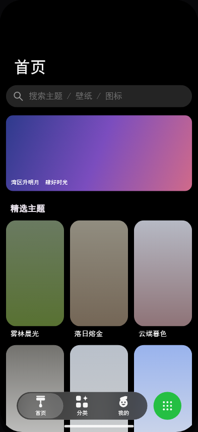 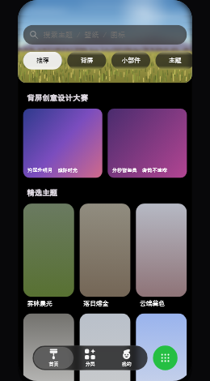 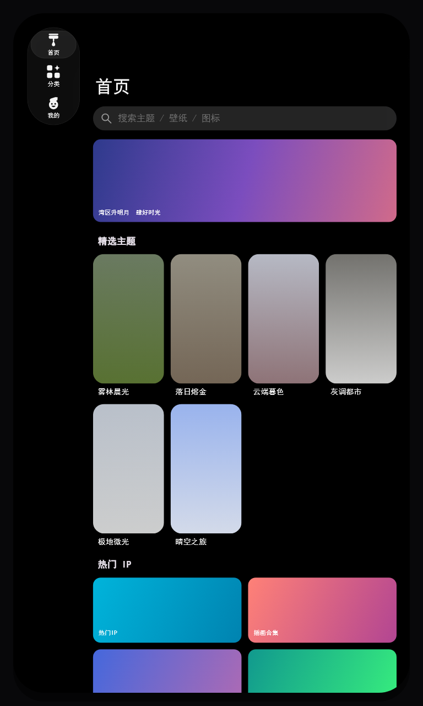 600 → 侧栏，主题卡 4 列" /> 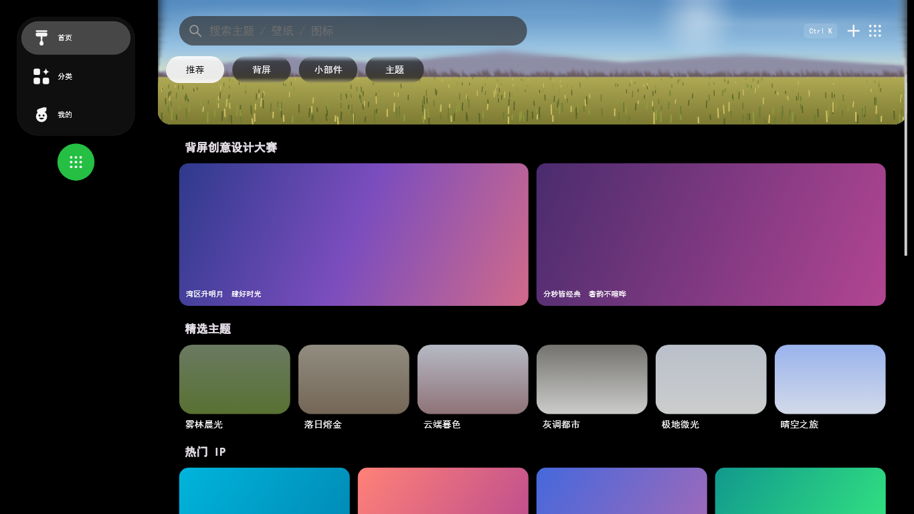

桌面浅色（侧栏玻璃体与投影落在浅底上，无拼接缝）：

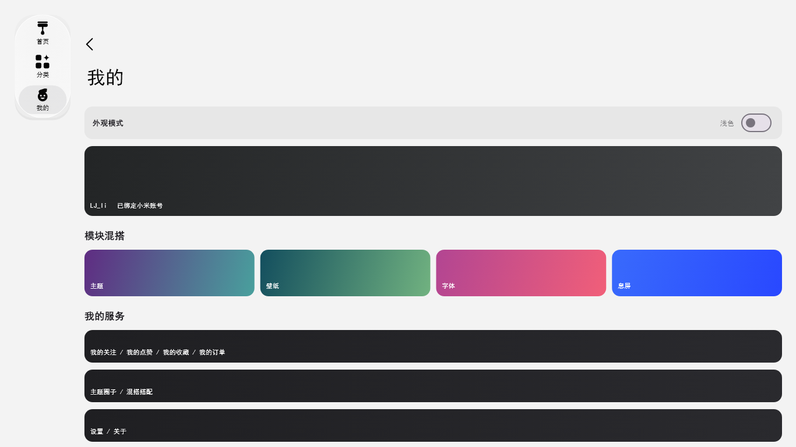


## 性能：每帧模糊预算

磨砂是这个框架最贵的绘制：`BackdropFilter` 每帧都要对 backdrop 重算一次
**全 QUAD 高斯**，滚动时 backdrop 一变就得重来。滚动掉帧基本都出在这里，
所以把「一次 build 里的模糊层数 + 覆盖面积（dp²，与 dpr 无关）」钉成预算
（`test/perf_budget_test.dart`）：

| 形态（深色） | 层数 / 覆盖面积 |
|---|---|
| 手机 393×856（底栏 + 顶栏 + 搜索栏） | 7 层 / 52,081 dp² |
| 平板 768×1280（侧栏；画面 720 → 页面列 599.1） | 首页 7 / 73,831 · 我的 6 / 49,527 · 分类 8 / 102,501 |
| 桌面 1366×768（侧栏；画面 1000 → 页面列 879.1） | 首页 7 / 101,430 · 分类 8 / 142,511 |

换侧栏**不是**多加磨砂换来的：页面列变窄、侧栏自己只挂 1 层
（95.4 × 177.1 = 16,896 dp²），所以平板/桌面的层数与底栏时代同量级
（优化前同一页 10 层 / 100,073 dp²）。

三条**零视觉差异**的优化（逐像素对比：最大灰度差 1~2 级，无任何像素差 > 2）：

1. **顶栏跳过被不透明叠色盖住的模糊段**：深色配方 0…63.6dp 的叠色是
   α = 1.000 纯黑，其下的模糊结果 100% 看不见 —— 8 段 / 119dp 降到 5 段 /
   45.4dp（`MiTopBar.visibleBlurBands`）。亮色叠色顶部只有 α 0.650，一段不省。
2. **胶囊行 4 个 BackdropFilter 合并成 1 个**：一次 `ClipPath` 裁出全部胶囊形状
   + 单个 backdrop 模糊（旧实现每个胶囊各一次高斯 + 一个 saveLayer）。相邻
   胶囊仍不串色 —— 模糊层先于所有填充绘制。
3. **σ 固定的 `ImageFilter` 缓存复用**（`src/utils/filter_cache.dart`）：避免每帧
   新建 native filter；另外 σ < 0.5dp 的段（高斯半径 < 1dp，亚像素）不绘制。

还有一个**交互层**的修正：切 tab 去掉了 260ms 淡入淡出。`FadeTransition` 会给
整页套 `Opacity` → 引入 saveLayer，而 saveLayer 会让下层 `BackdropFilter` 的
backdrop 变空（本项目实测过的坑）—— 切页期间旧页磨砂会消失、还多算一份全宽
高斯（实测模糊层 7 → 9、另有 6 层 opacity）。底部 tab 惯例本就是瞬时切换。

**验证方式**（务必在 profile 下看，debug 模式的渲染开销是 profile 的几倍，
「感觉丢帧」多半来自 debug 运行）：

```bash
flutter run --profile                       # 运行后按 P 打开性能 overlay
adb shell dumpsys gfxinfo com.example.bottom_nav_demo reset
# … 在应用里连续滚动 / 切 tab 约 20 秒 …
adb shell dumpsys gfxinfo com.example.bottom_nav_demo | Select-String "Janky frames"
```

## 设计原则
- **实测优先** — 视觉与动效参数以像素测量值为准，黄金图回归锁行为
- **组件自包含** — widget / 参数 / 绘制同目录组织，互不泄漏
- **token 驱动** — 颜色、文字、间距、材质统一走主题层，组件内不写字面量
- **API 最小暴露** — 只经 barrel 导出，内部实现可自由演进

## 架构

```
lib/
├── mi_like_ui.dart          # 入口导出层（barrel，唯一对外 API）
├── main.dart                # demo 引导
├── demo/                    # 示例层（演示 app）
└── src/
    ├── theme/               # 样式/主题层（颜色·文字·间距·材质·透明/磨砂 token，明暗双配方）
    ├── components/          # 组件层（类别/组件名/ 两级目录）
    │   ├── navigation/
    │   │   ├── glass_nav_bar/
    │   │   ├── glass_side_nav_bar/
    │   │   ├── pill_tab_bar/
    │   │   └── top_bar/
    │   ├── buttons/
    │   │   └── button/
    │   ├── inputs/
    │   │   └── search_bar/
    │   └── cards/
    │       └── theme_card/
    ├── icons/               # nav_icons.dart：导航栏 logo 合集（含加号 logo）
    └── utils/               # 工具函数层（纯函数 + 断点/缩放/响应式网格）

test/                        # 黄金图 + 交互测试
```

| 层 | 职责 |
|---|---|
| 导出层 `lib/mi_like_ui.dart` | 唯一对外 API 面 |
| 组件层 `src/components/` | 可复用组件：widget + metrics + painter |
| 主题层 `src/theme/` | 跨组件样式 token（玻璃/透明参数统一配置，组件同源取值） |
| 图标 `src/icons/nav_icons.dart` | 导航栏 logo 合集（`*IconPainter`） |
| 工具层 `src/utils/` | 无状态纯函数 |
| 示例层 `lib/demo/` | 演示 app，模拟真实使用方 |

## 约定

- 公共类 `Mi` 前缀（`MiGlassNavBar`、`MiColors`）；图标 painter 用 `*IconPainter`
- 文件名 snake_case 取事物名；组件常量进 `<组件名>_metrics.dart`
- 使用方与测试只 import barrel；未导出的 `src/` 实现即内部，不承诺 API 稳定

## 扩充新组件

1. `src/components/<类别>/<组件名>/` 建目录（widget / metrics / painter）
2. 样式取主题层 token，缺则先补 token
3. barrel 补一行 `export`
4. 测试与 demo 各补一例
5. `flutter analyze` + `flutter test` 全绿后提交

## 开发

```bash
flutter run      # 运行演示
flutter test     # 回归测试
```

## 路线图

- [x] `MiGlassNavBar` — 玻璃悬浮底部导航栏
- [x] `MiGlassSideNavBar` — 玻璃悬浮侧边导航栏（桌面模式，与底部栏同语义/同配方）
- [x] `MiPillTabBar` — 胶囊分类标签行
- [x] `MiButton` — 按钮
- [x] `MiSearchBar` — 搜索栏（与导航栏共用透明磨砂参数）
- [x] `MiTopBar` — 大标题折叠顶部导航栏（渐进磨砂材质）
- [x] `MiThemeCard` — 竖向预览卡片（主题商店精选卡）
- [x] `MiScaledCanvas` / `MiResponsiveGrid` / `MiViewport` — 断点与等比缩放（桌面/平板/手机自适应）
- [ ] `MiDialog` — 弹窗
- [ ] `MiForm` — 表单
- [ ] `MiTheme` — 主题聚合
